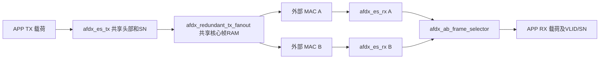

# AFDX V3 独立端系统技术说明书

版本日期：2026-10-07。工程根目录：`C:/Users/Admin/Documents/AFDX_PRJ/AFDX_v3/AFDX_v3`。设计顶层为 `AFDX_top`，仿真顶层为 `tb_afdx_end_system`。

V3 是从 V2 已验证数据通路移植出的**独立端系统原型**，包含共享 TX 封装、A/B 冗余复制、两路独立 RX 校验和完整身份消重。当前主入口只有一个 TX VL；未使用的四 VL 源码已删除，两路 RX 新增完整帧入口保护与内部异常统计。它已具备可运行的工程和自检仿真，但尚未实现赛题列出的全部功能，尤其是 SNMP、615A、RTC，以及容量与性能验收。

## 1. 赛题范围与工程边界

依据本地 [赛题.pdf](C:/Users/Admin/Documents/AFDX_PRJ/赛题.pdf) 第 4～6 页“任务要求”“技术要求”，交付对象是基于 Ethernet MAC 的 AFDX 端系统，主要工作包括 UDP/IP、发送缓冲与调度、接收处理和介质访问控制。题目没有明确要求把六个端系统和两个交换机全部实现为设计顶层。第 8 页要求最终使用 eLinx 编译和仿真，不要求完成实物硬件。

单个端系统仍需处理 A/B 双网络冗余；将交换网络放在 testbench 外部，不等于删除端系统内的复制、序列检查和消重。SNMP、615A、RTC 在题目功能清单中，不能因为简化为单端系统而忽略。V2 的 HTTP 管理页面不等于 SNMP 协议代理，也不能仅展示页面就声称已完成 SNMP。

|赛题内容|V3 当前实现|仍需完成|
|---|---|---|
|独立端系统|一个 APP 接口、一个共享 TX、两路 MAC 侧收发、两个 RX 和一个合并出口|明确最终 MAC 接口契约及题目模板对应关系|
|UDP/IP 与 ARINC664 Part 7|固定 Ethernet/IPv4/UDP 头、长度/校验处理、VLID/SN、BAG、双网复制消重|完整条款追踪、异常行为和配置模型验收；当前不能声明全面符合标准|
|高完整性处理|RX限长/超时/短帧保护、协议校验和回滚、内部异常统计、APP身份保持与冗余合并|进一步分类/快照、故障隔离和非法APP输入自动恢复|
|100 Mbps、最大帧|80 ns 时钟的 8 位字节流测试；核心帧最大 1514 字节、APP 最大 1471 字节|后期MAC/FCS/IFG契约及持续线速/拥塞吞吐测量|
|延迟 <1～2 ms、抖动几十 μs|主入口默认 BAG 为 1 ms；已提供自检平台|定义测量起止点，完成最坏负载统计，不能从 BAG 或时序裕量推导已达标|
|典型 128 TX / 4096 RX VL|主入口单 TX VL；每平面 RX 有 4096 项带完整标签的序列表；四 VL 扩展留在 V2|多 VL 全链路集成、容量扩展和冲突证明；4096 表项不等于已验收任意 4096 个 VL|
|SNMP / 615A / RTC|尚未实现|真实协议功能和相应测试|
|eLinx 编译/仿真|去除 FIFO Generator 专有 IP，提供本地 RTL/TB 清单和 SDC|当前未执行 eLinx；仍需目标工具编译、RAM 映射和仿真验收|

## 2. 项目结构与移植内容

实际工程位于用户已有目录内层 `AFDX_v3/AFDX_v3`，没有另建同名替代工程。

```text
AFDX_v3/                         外层导航目录
  README.md
  AFDX_v3/                       实际工程根目录
    AFDX_v3.xpr                  用户原有 Vivado 工程，已登记源文件
    README.md                    使用入口与文档索引
    AFDX_v3.srcs/
      sources_1/new/             22 个 RTL 文件
      sim_1/new/                 10 个自检 testbench
    constraints/
      mac_stream_80ns.xdc        Vivado 内部时钟约束
      mac_stream_80ns.sdc        其他工具移植时钟约束起点
    tools/
      run_regression.py          V3 独立 ModelSim 编译/回归
      project.tcl               登记工程 / XSim / 综合
      check_project.py           登记、来源哈希及验证证据检查
      source_index.py            本地源码词法提取器
      build_docs.py              重建变量/函数/端口附录
      rtl_sources.f             本地相对路径 RTL 清单
      testbench_sources.f       本地相对路径 testbench 清单
    docs/
      技术说明书.md
      函数与变量明细.md          每项声明、函数输入输出、作用和写入证据
      拓扑与端口连接.md          全部模块例化及逐端口表达式/传递原因
      进度说明.md
      下一步目标与未完成清单.md
      统计寄存器说明.md         34项有效计数与2个保留地址、原因与清零规则
      module_purpose.json        逐模块主要功能、必要性、位置和过程
      测试报告.md
      migration_manifest.json   V2 来源及 V3 目标 SHA256
      source_semantics.json     经校订的逐变量语义数据
      source_inventory.json     完整源码引用、依赖及哈希
      verification.json         工程检查和回归证据汇总
    artifacts/                  实际执行日志、综合报告、DCP
    AFDX_v3.sim/                 Vivado 生成仿真目录
    AFDX_v3.runs/                Vivado 生成综合目录
```

初始移植记录保留在 manifest。本轮删除未接入主入口的 `afdx_es_multivl_top`、`afdx_vl_queue`、`afdx_vl_csr`、专用 `tb_afdx_vl_csr` 和一次性迁移脚本。新增 `afdx_rx_ingress_guard`、`afdx_es_stats`、`tb_afdx_rx_protection_stats`；现在全部22个RTL模块都能从AFDX_top例化关系到达，10个TB用于实际回归。统计观测端口不改变原复制/消重判定。来源及目标哈希保存在 [migration_manifest.json](C:/Users/Admin/Documents/AFDX_PRJ/AFDX_v3/AFDX_v3/docs/migration_manifest.json)；原 V2 被复制文件保持不变。

V3 的编译/仿真使用自己的本地文件，不依赖 V2 RTL、交换机、HTTP 服务、旧管理台或 FIFO Generator 仿真库。来源检查工具为审计目的读取 V2；这不是运行数据通路的依赖。一次性迁移脚本已从V3移除，防止再次导入已清理的扩展。

## 3. 主拓扑与模块连接



图中外部 MAC 和网络不是当前综合顶层里的模块。testbench 通过抓取 TX 核心帧并按各路 RX ready 注入，模拟 MAC 侧外部交通；只例化一个真实端系统 DUT。

|层级/实例|子模块|传递的关键内容及原因|
|---|---|---|
|`AFDX_top.u_tx`|`afdx_es_tx`|APP 字节、valid/ready/last；统一生成头部和 SN，避免两个平面独立推进产生不同身份|
|`AFDX_top.u_fanout`|`afdx_redundant_tx_fanout`|共享核心 data/last、A/B各自ready；缓存完整帧后固定复制，由两个独立游标发送|
|`AFDX_top.u_rx_a/u_rx_b`|`afdx_es_rx`|每路核心帧和独立复位；分别完成协议、长度、序列和事务提交，坏帧不会进入 APP|
|`AFDX_top.u_merge`|`afdx_ab_frame_selector`|每路已校验载荷与完整 16 位 VLID、8 位 SN；仅凭 SN 会把不同 VL 的同 SN 帧误判为重复|
|TX 帧管理器|`fifo_ip_tx`、`frame_descriptor_fifo`|载荷数据和完整帧长度分开排队；只有 APP last 握手后才产生可调度描述|
|TX 调度器|`bag_timer`|队列非空、发送 busy、实际首字节事件；首字节间隔在真实握手时装载计时|
|TX 输出器|`packet_builder`、`sequence_counter`、`afdx_tx_switch_stream`|描述长度/SN、字节请求与下一拍应答；弹性缓存将内部请求式接口转成外部反压流|
|RX 解码器|`afdx_rx_parser`、`afdx_rx_sequence_table`|解析字段、帧身份、序列检查请求及结果；检查完成后决定 commit/abort|
|RX 帧管理器|载荷 RAM 和长度/VLID/SN 描述符|候选写入可回滚；只有 commit 才能被 APP 消费；元数据随完整帧保持|

这些模块是并行硬件，由时钟边沿驱动，不是按表格顺序执行的软件函数。`data`、`valid`、`last` 随数据方向传递，`ready` 反方向传递；上升沿 `valid && ready` 才完成一个字节。发生反压时，上游必须保持有效字节及帧尾/身份。

全部实际子模块参数和端口映射见 [拓扑与端口连接.md](C:/Users/Admin/Documents/AFDX_PRJ/AFDX_v3/AFDX_v3/docs/拓扑与端口连接.md)。每个模块、function/task 的每项声明、类型/位宽、默认值、作用、赋值及源码行见 [函数与变量明细.md](C:/Users/Admin/Documents/AFDX_PRJ/AFDX_v3/AFDX_v3/docs/函数与变量明细.md)。本版附录包含 32 个设计/测试模块、39 个 HDL function/task、1101 条作用域声明记录和 448 个例化端口连接；隐式模块依赖另列，完整引用在 JSON 中保存。

## 4. 顶层接口与配置

|接口组|方向（相对于 ES）|内容与约束|
|---|---|---|
|`clk/reset`|输入|统一时钟；`reset` 高有效，内部多数模块转换为低有效 `sys_rst_n`|
|`app_tx_data/valid/last`|输入|合法 APP 载荷流，1～1471 字节，last 与最终有效握手字节对齐|
|`app_tx_ready`|输出|载荷/描述队列有空间时可接受；A/B固定参与冗余发送|
|`app_rx_data/valid/last`|输出|合并后只交付一次的已校验载荷；不足 17 字节的载荷保留补零部分|
|`app_rx_ready`|输入|APP 可接收；为 0 时数据、last、VLID、SN 全部保持|
|`app_rx_vl_id/sequence_number`|输出|完整帧身份旁带，仅在 app_rx_valid 时有效，全帧/停顿期间对齐|
|`tx_a_data/valid/last`、`tx_b_data/valid/last`|输出|A/B MAC 侧核心帧，不含 FCS；各自 ready 为输入|
|`rx_a_data/valid/last`、`rx_b_data/valid/last`|输入|MAC 已整理的核心帧；各自 ready 为输出|
|`stats_addr/stats_clear`|输入|统计字节地址/同步清零请求，36个32位统计地址槽，34项有效、2项保留为零|
|`stats_rdata/stats_error`|输出|组合统计读回/地址未对齐或越界错误|

按用户本轮安排，开发使用Vivado，V3-P0-1（eLinx）与V3-P0-2（MAC模板对照）暂缓，允许按当前端系统需要调整调试接口。赛题示意模板中的 `tx_ready/rx_ready` 方向与本工程 conventional ready/valid 的命名方向可能不同。V3 没有把方向硬反转来机械套模板；下一阶段需要明确这些信号在题目中是下游接受能力、MAC 请求还是内部观察输出，并形成适配层和对照测试。当前不能声称接口与示意模板逐引脚一致。

|参数|主入口默认值|作用|
|---|---|---|
|`BAG_CYCLES`|12500|在 80 ns 时钟下为 1 ms；改变时钟必须重算，子模块单独例化的旧默认值未统一修改|
|`DEDUP_WINDOW_CYCLES`|100000|80 ns 下 8 ms；控制迟到副本保留历史；测试使用 20000（1.6 ms）|
|`RX_IDLE_TIMEOUT_CYCLES`|12500|80 ns下1 ms；未结束输入持续无valid时丢弃，完整帧正常反压不计时|
|`TX_IDLE_TIMEOUT_CYCLES`|12500|APP TX缺last的独立输入空闲诊断阈值，只统计、不自动回滚TX|
|`HISTORY_DEPTH`|64|关联消重历史容量；已占用未过期记录不强制覆盖，满则反压|
|`DEST_MAC/SRC_MAC`|030000000101 / 020000000001|TX 固定 MAC，目的 MAC 低 16 位为 VLID 0101|
|`SRC_IP/DEST_IP`|192.168.0.1 / 192.168.0.3|固定 IPv4 地址|
|`SRC_PORT/DEST_PORT`|10001 / 20003|固定 UDP 端口|
|`LOCAL_DEST_IP/PORT`|192.168.0.3 / 20003|RX 允许目的 IP/UDP 端口|
|`ACCEPT_ANY_DEST`|0|默认保留目的过滤；测试需要另行配置时才放宽|

消重窗口必须同时大于系统允许的 A/B 副本时差、小于相同 VL 序列号合法复用的最短时间。SN 为 1～255，回绕到 1；SN=0 被拒绝。默认 1 ms BAG 对应理想最短 SN 复用约 255 ms，但接收配置、多源和重启行为仍需要完整规则与测试。

## 5. 发送、存储与时序

`afdx_tx_frame_manager` 在 APP 握手时把 `{last,data}` 写入 9 位 FIFO，APP last 同拍把累计长度写入描述 FIFO。描述未形成前不发送。`afdx_tx_frame_scheduler` 在队列有完整帧、输出非 busy、BAG 计时允许时弹出描述；发送器锁存长度。

`packet_builder` 生成 42 字节 Ethernet/IPv4/UDP 固定头、原载荷、必要补零和一个尾部 SN。核心长度为 `42 + max(17,载荷长度) + 1`，因此为 60～1514 字节，若 MAC 增加 4 字节 FCS 则为 64～1518 字节。IPv4 校验和由头部字段计算；TX UDP checksum 为 0。RX 路径对收到的非零 UDP checksum 进行校验。

V3 的 `fifo_ip_tx` 保留旧 Standard 同步读接口，内部改为 `afdx_sync_fifo`：默认 2048×9、同钟、同步高有效复位、读请求被接受的时钟沿后更新 dout，空读保持、满写拒绝、同时有效读写计数保持。指针按位宽回绕，要求 `DEPTH == 2**ADDRESS_WIDTH`。RAM 数据本身不复位，复位控制指针/计数/output 即可。旧 11 位计数端口不能表示 2048，因此全满时饱和 2047；满判断必须使用 full，不能仅凭该旧计数。

`afdx_tx_switch_stream` 的两项弹性缓存包含对在途读请求的空间预留，避免外部突然反压时覆盖数据。更换 FIFO 时没有改成 FWFT，保留了 builder 下一拍接收读应答的契约，并由 FIFO、TX 链路和主系统测试验证。

`afdx_redundant_tx_fanout` 捕获完整核心帧，固定复制给A/B。两路拥有独立游标与实际首握手BAG计时，快端完成后不会重复发送；慢端暂停时保留原副本，恢复后从原字节继续。两路都完成才释放共享缓存，因此任一路ready长期为0会最终阻塞后续TX，当前不提供自动故障绕过。


## 6. 接收与完整身份消重

A/B是两个独立接收入口，没有运行中固定选择某一路的开关。合并器只对完整通过校验的载荷做选择，最先完整进入合并缓存者优先，同拍A优先；同VLID/SN迟到副本在窗口内丢弃，不同身份的帧均保留交付。选择后整帧锁定来源，APP停顿也不切换。接收来自哪一路不影响发送：APP TX始终重新封装并复制给A/B，没有自动沿原接收端口回复的行为；APP接口当前也没有来源端口标志。

每路首先经 `afdx_rx_ingress_guard` 保存完整核心帧，60～1514字节带last后才送解析器。第1514字节无last即可确认超长，转入排空而不继续写RAM；不足60字节的结束帧直接拒绝；未完成输入连续无valid达到阈值时清半帧。两路各自独立，因此同时异常也不会共享一个恢复状态。

`afdx_rx_parser` 根据握手字节位置累积 MAC/IP/UDP 字段，把偏移 42 后的非 last 字节作为候选载荷；最后的核心字节是 SN。帧尾对协议字段、长度范围、目的地址及校验和做检查。`packet_decoder` 请求相应 VL 序列检查并等待结果，再选择 commit 或 abort。

每个 RX 的序列表默认 4096 项，用 VLID 低 12 位寻址，条目保留完整 16 位标签。标签相同且 SN 重复或为 0 时拒绝；跳号被接受并报序列错误；不同标签碰撞替换原条目。这解决了简单截取 VLID 造成误比较的问题，但不保证任意 4096 个 VLID 无冲突，也不提供完整的可配置接收 VL 表。

序列表复位后逐项清 valid，需要约 4096 个时钟；80 ns 下约 327.68 μs，期间decoder不能处理核心流，但入口保护可先捕获一份完整帧并等待；入口缓存满时对外反压。两路仅在全局reset后重新初始化，无独立平面开关。该时间应纳入最终恢复性能评估。

`afdx_rx_frame_manager` 将候选载荷写入环形 RAM，候选帧具有回滚起点。只有 commit 才向 APP 描述 FIFO 发布长度/VLID/SN；abort 回滚候选，描述空间或载荷空间不足时排空非法候选。APP 接口仅能看到完整已提交帧。

`afdx_ab_frame_selector` 各有一份完整载荷缓存，最早完整的帧优先，同拍完成时 A 优先。以完整 `(VLID,SN)` 扫描关联历史，每拍一个条目；命中丢弃副本，未命中先预留历史项再输出，防止 APP 长时间停顿期间重复帧穿透。APP last 握手刷新窗口时间；活动记录全程受保护。历史满则保留候选并反压直到有过期空位。这个有限容量策略意味着历史容量、窗口和活跃 VL 流量必须共同规划。

## 7. RX非法输入保护与内部统计

RX入口每路有一份1514字节有限缓冲，完整合格帧等待解析器时禁止新输入覆盖。输入超长后的排空状态接收但不存储，直到last或连续空闲边界恢复；已计超长的流不会因退出排空再计一次超时。没有last的有限半帧超时后可接收新帧。协议头声明长度与实际长度不符、校验失败仍由原parser拒绝，非法数据不提交给APP。

完整帧反压期间不运行入口缺帧计时，正常停顿不会导致合法数据被误丢。接口只有last，没有独立帧首；缺last后若下一帧无任何可辨识边界而连续到来，继续排空至last或空闲边界。完整帧前置存储增加每路最多一帧的捕获延迟和RAM成本，最终吞吐/延迟需后续测量。

内置 `afdx_es_stats` 保留36个32位统计地址槽，34项有效，0x0C/0x10固定为零；包含TX实际帧/核心及APP超长/APP半帧超时，两路RX入口完整/提交/丢弃及分类原因，同路和双网重复、最终APP交付及流控周期。统计只随全局reset或stats_clear清零。字节地址0x00..0x8c，四字节对齐，非法读返回0并置error；clear优先同拍事件，不复位数据通路。

完整地址和事件口径见 [统计寄存器说明.md](C:/Users/Admin/Documents/AFDX_PRJ/AFDX_v3/AFDX_v3/docs/统计寄存器说明.md)。丢弃总数与分类原因会重叠；跳号计数是不连续事件，不能直接还原丢失帧数量。正常A/B消重和反压属于运行观察，不能全部按故障解释。TX输入诊断只统计，缺last自动回滚仍待实现。

未使用的四VL模块及专用TB已清理，今后需要多VL时从V2参考设计重新规划，不作为当前V3已经具备的能力。

## 8. 工具函数与运行方法

在实际工程根目录执行。ModelSim 路径可用 `AFDX_MODELSIM` 环境变量配置，默认 `C:/Develop/Modelsim/win64`；Python 路径按本机运行环境设置。

```powershell
python tools/run_regression.py
python tools/run_regression.py --tests tb_afdx_end_system
vivado -mode batch -nojournal -source tools/project.tcl -tclargs configure
vivado -mode batch -nojournal -source tools/project.tcl -tclargs simulate tb_afdx_end_system
vivado -mode batch -nojournal -source tools/project.tcl -tclargs synthesize tb_afdx_end_system
python tools/build_docs.py
python tools/check_project.py
```

`project.tcl` 配置 sources_1/sim_1/constrs_1；仿真运行到自检 $finish；综合生成本地 DCP、利用率及时序报告。该主机沙箱会使 Vivado 2018.3 的旧 Windows 路径 API 错误解析 Documents，实际成功执行使用了本地沙箱外工具运行。首次失败日志保留，成功日志与最终报告另有明确标记；没有修改源目录来绕过路径问题。

|工具函数/过程|输入|输出与副作用|
|---|---|---|
|`run_regression.execute(argv,folder,log,timeout=300)`|命令数组、工作目录、日志路径、超时秒数|返回 subprocess CompletedProcess；追加命令和 stdout/stderr，超时抛异常|
|`run_regression.main()`|命令行可选 --tests，AFDX_MODELSIM 路径|编译本地 RTL/TB，运行自检；写逐测试日志/哈希/summary/latest，返回退出码 0 或 1|
|`check_project.main()`|XPR、实际源文件、来源 manifest、latest 回归、文档源码哈希和XSim/综合日志|校验分类/来源、主顶层可达性及证据，写 verification.json，返回 0 或 1；来源审计读取旧 V2|
|`source_index.no_comments(text)`|HDL 文本|去注释并保持行数的文本|
|`source_index.balanced(text,start)`|文本、起始左括号索引|括号内内容和右括号后索引；不平衡抛异常|
|`source_index.declarations(text,splitter=',')`|端口声明文本、分隔符|每个端口方向、类型和位宽记录，延续同组声明属性|
|`source_index.port_description(name)`|端口名|语义或依据 data/valid/last/ready 后缀构造的说明；未知抛异常|
|`source_index.extract_interfaces(path,vendor=False)`|源码路径及分类标志|模块参数/端口和 callable 接口目录|
|`source_index.split_top(text,sep=',')`|含嵌套表达式的文本|只在顶层分隔的字符串列表|
|`source_index.callable_spans(text)`|HDL 模块体|function/task 名称、范围、接口与函数体位置|
|`source_index.decls(text,offset=0)`|作用域文本、偏移|各项变量/常量声明、数组、初值及偏移|
|`source_index.usage(text,name,start_line)`|作用域、变量名、起始行|所有词法引用、赋值表达式、条件引用；不是 HDL 数据流形式证明|
|`source_index.instances(body,names,start_line)`|模块体、已知模块名集合、起始行|实例、参数及端口连接表达式和源码行|
|`source_index.extract_hdl(path,module_catalog)`|源码与模块目录|模块作用域变量、实例、函数局部量及隐式全局依赖|
|`build_docs.cell(value)` / `link(path,line)`|表格值 / 源码路径和声明行|转义 Markdown 单元格 / 绝对源码链接|
|`build_docs.role(owner,var,instances=())`|所属模块、声明记录、子模块连接|经校订作用；缺少说明即报错，不静默遗漏变量|
|`build_docs.variables_table(owner,variables,instances,path)`|作用域及逐变量证据|包括作用/写入/源码的 Markdown 表格行列表|
|`build_docs.main()`|V3 本地源码、source_semantics.json和module_purpose.json|重建两份明细、完整 inventory 和 RTL/TB 相对路径清单|
|`project.tcl` 顶层过程|argv[0] configure/simulate/synthesize、argv[1] TB 名|登记用户已有工程，按模式仿真或综合；日志、时序、DCP；失败退出|

工具中的 ROOT/RTL/TB 指定本地项目与两个文件集；sources/paths/catalog 记录文件及模块声明；variables/instances 保存作用域和连接证据；results/summary 保存实际检查结论；folder/log 保存单次执行产物；hashes 用于关联代码与测试。HDL 的每项变量不能由这些工具变量代替，实际逐项说明见附录。

## 9. 已知限制

目前 APP 发送端信任上游提供合法长度和 last。超长 APP 帧或缺 last 可能使载荷 FIFO 填满后无法形成描述，造成阻塞；不能用当前合法流回归推断非法输入已防护。RX 拒绝/回滚覆盖与 TX 非法输入保护是不同事项。

没有完整 Ethernet MAC、FCS、前导码、IFG 和不可反压线速输入适配；当前 RX 允许对外部模型反压。没有把 V2 GMII 演示 adapter 当成合格 MAC 移植。SDC/XDC 仅约束内部 80 ns 时钟，没有真实 MAC 的输入/输出延迟，综合报告不能替代接口时序、布局布线或 eLinx 验收。

下一步按 [目标与未完成清单](C:/Users/Admin/Documents/AFDX_PRJ/AFDX_v3/AFDX_v3/docs/下一步目标与未完成清单.md) 推进；实际完成证据见 [测试报告](C:/Users/Admin/Documents/AFDX_PRJ/AFDX_v3/AFDX_v3/docs/测试报告.md)。
