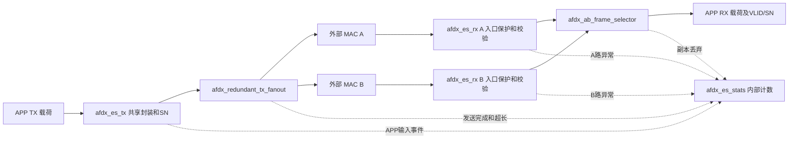

# V3 拓扑与逐端口连接

本文件先解释每个模块做什么、为什么需要它、位于哪里，再列出真实源码的子模块参数与逐端口连接。覆盖 22 个主入口实际使用的 RTL 模块和 10 个 testbench；未接入的四 VL 扩展已从 V3 删除，testbench 只用于仿真。

参数决定编译期配置；data/valid/last 沿数据方向传递，ready 反向反馈；上升沿 valid && ready 才推进一个字节。长度描述标识完整帧边界，VLID/SN 旁带维持帧身份，commit/abort 决定候选帧是否能交付。模块按时钟并行工作，箭头表示数据或控制连接。

## 主端系统拓扑

图中外部 MAC 不在当前综合顶层内。共享 TX 先产生一次完整核心帧再复制；两路 RX 各自先做有限完整帧捕获、超长/缺帧保护，再解析及提交，最后以完整 VLID/SN 合并交付。A/B仅共享全局reset，无独立开关或许可回显。接收选择最先完整通过检查并进入合并缓存的帧，同拍A优先；输出期间锁定整帧来源。发送每帧固定复制给A/B，两路ready分别推进，均完成才释放缓存。内部统计经 stats_addr/rdata/error 读出，stats_clear 同步清零，0x0C/0x10保留为零。

## 模块索引

|模块|主要功能|在项目中的位置|
|---|---|---|
|afdx_ab_frame_selector|分别缓存 A/B 已验证的完整载荷，以完整 (VLID,SN) 查询关联历史并丢弃重复副本；最先完整的帧优先，同拍 A 优先；输出载荷及身份，停顿时保持。|主顶层 u_merge，位于两路 RX 提交出口与统一 APP RX 之间。|
|afdx_es_rx|连接MAC侧完整帧保护、packet_decoder和接收事务缓冲，把经过限长、超时、协议和序列检查的帧转换为载荷及VLID/SN，并上报每路异常事件。|主顶层 u_rx_a/u_rx_b 各一份，具有独立平面复位和序列表。|
|afdx_es_stats|36个32位饱和计数地址槽，其中34项运行/异常统计有效，0x0C/0x10保留为零；组合读取、统一清零，并诊断APP TX超长与半帧输入超时。|AFDX_top.u_stats；全局reset或stats_clear清计数。|
|afdx_es_tx|组合发送帧管理器与报文输出器，把 APP 载荷流变成带 Ethernet/IPv4/UDP 头、padding 和 SN 的核心帧流，并支持输出反压。|主顶层 u_tx；A/B 复制前只有一份共享实例。|
|afdx_header_builder|根据头字节索引输出固定 Ethernet/IPv4/UDP 头；由补齐后的载荷长度计算 IP/UDP 长度和 IPv4 校验和，TX UDP checksum 字段为 0。|主 TX builder 的 u_header_builder，为组合计算叶子模块。|
|afdx_redundant_tx_fanout|1514字节共享核心帧RAM；每个合法帧固定向A/B复制，独立游标与实际首握手BAG；两路都完成才释放缓存，超长排空。|主顶层 u_fanout，位于共享 TX 封装之后、两个外部 MAC 之前。|
|afdx_rx_frame_manager|用环形 RAM 保存候选载荷，记录回滚起点；commit 时发布长度/VLID/SN 描述，abort 时撤销候选；APP 反压时保持已提交帧的输出及身份。|每路 RX 的 u_frame_manager，位于解码器与双网合并器之间。|
|afdx_rx_ingress_guard|在MAC侧保存一份完整核心帧，限定60～1514字节；超长立即转入排空，半帧输入停止达到可配置超时后丢弃；合格完整帧才送解析器。|每路afdx_es_rx的u_ingress_guard，两路各一份，位于外部MAC和packet_decoder之间。|
|afdx_rx_parser|按握手字节位置提取 Ethernet/IPv4/UDP 字段和候选载荷，在核心帧尾识别 SN，校验协议、目的地址、长度以及 IP/UDP checksum，输出帧身份和解析结果。|每路 RX 解码器的 u_rx_parser。|
|afdx_rx_sequence_table|保存每个直接映射槽的完整 VL 标签与最近 SN，复位逐项清 valid；拒绝 SN0 和同标签重复 SN，跳号接受并报错，标签冲突时替换。|每路 RX 解码器的 u_sequence_table；默认 4096 项直接映射，容量及标签冲突策略仍需按最终 VL 配置验收。|
|afdx_sync_fifo|实现可推断的同钟同步 FIFO，默认 2048×9；用读写指针和占用计数管理 RAM，接受读请求的时钟沿后更新 dout，提供 full/empty。|主 TX 的存储叶子模块，由 fifo_ip_tx 例化。|
|AFDX_top|共享发送封装/SN、固定A/B复制、两路独立RX校验和身份消重组成独立端系统。两路仅由统一reset复位，A/B命名对称；统计36个地址槽，34项有效、2项保留为零。|主设计顶层。当前发送端只有一个 TX VL；外部 MAC 和交换网络由接口或测试模型提供。|
|afdx_tx_frame_manager|接收 APP 握手字节，将 data/last 存入载荷 FIFO，累计帧长，在 last 握手时提交长度描述，并连接发送调度器。|主 TX 的 u_frame_manager；当前仍信任 APP 提供合法长度及 last。|
|afdx_tx_frame_scheduler|组合完整帧描述 FIFO 与 BAG 计时器，在有完整帧、发送器空闲且 BAG 到期时产生调度许可，并弹出队首长度描述。|主 TX 帧管理器的 u_frame_scheduler。|
|afdx_tx_packet_output|连接序列计数器、packet_builder 与两项弹性输出缓存；锁存调度信息，生成核心字节流，并将 busy 保持到核心流尾字节被接受。|主 TX 的 u_packet_output，输出接到冗余复制器。|
|afdx_tx_switch_stream|将 builder 的请求/下一拍应答接口转换为 ready/valid/last 输出，使用两项缓存并为在途请求预留空间，反压时保持队首字节。|主 TX 报文输出器的 u_switch_stream；名字沿用旧版本，当前下游是 fanout。|
|bag_timer|从 frame_transmit_start 装载 BAG_CYCLES-1 并倒计时，在计数到期、队列有帧且发送不忙时产生 bag_grant。|主 TX 调度器的 u_bag_timer；这里的 start 是共享核心输出流首字节握手，A/B MAC 侧实际首握手另由 fanout 检查。|
|fifo_ip_tx|把 APP 的 8 位 data 与 1 位 last 合并为 9 位存储项，对写/读请求做 full/empty 保护，再拆出同步读数据。V3 内部使用 afdx_sync_fifo，旧模块名保留。|主 TX 帧管理器的 u_payload_fifo。|
|frame_descriptor_fifo|按帧保存长度描述，提供队首长度、空满及计数；支持合法的同时入队/出队，保护空读和满写。|主 TX 调度器的 u_frame_descriptor_fifo。|
|packet_builder|在调度许可时锁存长度及 SN，按字节请求依次生成 42 字节头、同步 FIFO 载荷、短帧补零和尾部 SN，仅 SN 字节标记核心 last。|主 TX 报文输出器的 u_packet_builder。|
|packet_decoder|协调协议解析、存储空间反馈与按 VL 序列检查；解析失败、溢出或描述空间不足时 abort，检查通过时 commit，并在检查期间控制网络反压。|每路 RX 的 u_packet_decoder。|
|sequence_counter|提供 1～255 的 TX 序列号，复位为 1，收到 frame_transmit_done 时推进，255 后回到 1，其余时刻保持。|主 TX 报文输出器的 u_sequence_counter；计数发生在复制之前。|
|tb_afdx_ab_delayed_copy|先从 A 交付一帧，再延迟注入同一 VLID/SN 的 B 副本，检查 APP 最终只收到一次。|仿真迟到副本专项回归，例化 afdx_ab_frame_selector。|
|tb_afdx_ab_selector|同拍A优先、B先完整即优先、延迟旧SN副本、跨VL同SN、APP长时间反压、窗口过期、历史满不覆盖、260帧SN回绕、计时回绕、A先开始但B先完整以及超长排空。|仿真消重单测，例化 afdx_ab_frame_selector。|
|tb_afdx_app_to_switch|向 afdx_es_tx 注入不同长度的 APP 载荷，检查不完整帧不发送、短帧补零、头/载荷/SN/last 和输出反压，包含连续帧压力。|仿真 TX 链路测试，名称沿用 V2；只例化 afdx_es_tx，没有交换机 DUT。|
|tb_afdx_core_controls|分别测试描述 FIFO 的空满与顺序、BAG 许可间隔，以及 SN 保持和 255→1 回绕。|仿真测试模块，例化 frame_descriptor_fifo、bag_timer 和 sequence_counter。|
|tb_afdx_end_system|真实AFDX_top：9份共享TX帧在A/B各发送一次，10次完整身份APP交付；覆盖单路RX、同时RX、双端TX停顿及B半帧暂停后完整恢复。|V3 默认仿真顶层，不属于综合设计；外部 MAC 交通用行为任务驱动。|
|tb_afdx_redundant_tx_fanout|快速端不重复、A/B角色互换、B半帧暂停恢复、双端暂停、60帧非对称反压、最大/超长恢复、每路实际BAG至少50周期；按每字节与last自检。|仿真冗余发送单测，例化 afdx_redundant_tx_fanout。|
|tb_afdx_rx_protection_stats|在一个真实AFDX_top上同时注入双路超长、缺last、短帧与长度错误，检查恢复、最大帧、正常长反压以及TX/RX分类计数、读地址、饱和和清零。|新增仿真测试模块；主DUT是AFDX_top，另例化afdx_es_stats验证饱和边界。|
|tb_afdx_sequence_table|直接发送 VLID/SN 检查请求，验证初始化屏障、重复及 SN0 拒绝、连续与回绕、跳号接受以及标签冲突替换。|仿真测试模块，例化 afdx_rx_sequence_table。|
|tb_afdx_switch_to_app|向 afdx_es_rx 注入合法与长度错误的核心帧，检查最大载荷边界、非法帧回滚、合法 APP 输出及连续帧/反压恢复。|仿真 RX 链路测试，名称沿用 V2；只例化 afdx_es_rx，没有交换机 DUT。|
|tb_afdx_sync_fifo|驱动小容量 afdx_sync_fifo，逐项自检空读/满写、同步读时序、data/last 顺序、指针回绕、同时读写和同步复位。|仿真测试模块，例化 afdx_sync_fifo；不属于 AFDX_top 综合层级。|

## afdx_ab_frame_selector

**主要功能：** 分别缓存 A/B 已验证的完整载荷，以完整 (VLID,SN) 查询关联历史并丢弃重复副本；最先完整的帧优先，同拍 A 优先；输出载荷及身份，停顿时保持。

**为什么需要：** A/B 同一逻辑帧可能先后到达，而且 APP 可能长时间暂停。完整身份历史区分同一副本和不同 VL 的同 SN 帧，预留并保护活动历史项使输出等待期间仍能正确消重，完整帧缓存保持交付不交织。

**在项目中的位置：** 主顶层 u_merge，位于两路 RX 提交出口与统一 APP RX 之间。

**连接与工作过程：** A/B payload + VLID/SN → 各路完整帧 RAM；候选身份 → 历史扫描/预留；选定 RAM → APP；APP 尾握手刷新历史时间，重复候选释放缓存。

[afdx_ab_frame_selector.v:10](C:/Users/Admin/Documents/AFDX_PRJ/AFDX_v3/AFDX_v3/AFDX_v3.srcs/sources_1/new/afdx_ab_frame_selector.v:10)

本模块未例化 V3 子模块，内部状态/计算见变量明细。

## afdx_es_rx

**主要功能：** 连接MAC侧完整帧保护、packet_decoder和接收事务缓冲，把经过限长、超时、协议和序列检查的帧转换为载荷及VLID/SN，并上报每路异常事件。

**为什么需要：** 接收接口要同时协调网络输入、最终检查结果和 APP 读取速度。该封装层使候选数据只能在检查通过后被发布，并把身份和载荷连接到后续双网合并器。

**在项目中的位置：** 主顶层 u_rx_a/u_rx_b 各一份，具有独立平面复位和序列表。

**连接与工作过程：** MAC核心流→u_ingress_guard→u_packet_decoder；候选载荷和commit/abort→u_frame_manager；已提交载荷/VLID/SN→双网合并器；rx_events→内部统计。

[afdx_es_rx.v:4](C:/Users/Admin/Documents/AFDX_PRJ/AFDX_v3/AFDX_v3/AFDX_v3.srcs/sources_1/new/afdx_es_rx.v:4)

### u_ingress_guard → afdx_rx_ingress_guard

[afdx_es_rx.v:42](C:/Users/Admin/Documents/AFDX_PRJ/AFDX_v3/AFDX_v3/AFDX_v3.srcs/sources_1/new/afdx_es_rx.v:42)

|子模块项|方向/种类|上层表达式|为何传递|
|---|---|---|---|
|IDLE_TIMEOUT_CYCLES|parameter|RX_IDLE_TIMEOUT_CYCLES|入口保护无输入valid的连续空闲阈值，要求正整数。|
|sys_clk|input|sys_clk|模块工作时钟，上升沿更新状态。|
|sys_rst_n|input|sys_rst_n|低有效复位，异步/同步形式以各模块always定义为准。|
|in_data|input|rx_data|MAC侧核心字节。|
|in_valid|input|rx_valid|MAC侧字节有效；无valid且已有半帧时启动空闲计时。|
|in_last|input|rx_last|MAC核心帧最后一字节标记。|
|in_ready|output|rx_ready|本路可接收；完整帧输出前保持反压，捕获/排空期间可接受。|
|out_data|output|guarded_data|已完整捕获核心帧的当前字节，反压期间保持。|
|out_valid|output|guarded_valid|完整核心帧可供decoder读取。|
|out_last|output|guarded_last|完整帧的最后一字节，与out_valid对齐。|
|out_ready|input|guarded_ready|decoder接受能力；0时不推进read_pointer，也不触发缺帧超时。|
|complete_event|output|ingress_complete|60..1514字节合法边界帧尾握手事件，只表示入口完整，不表示协议/序列已通过。|
|oversize_event|output|ingress_oversize|第1514字节被接受且无last的首次超长事件；每次非法流只计一次。|
|timeout_event|output|ingress_timeout|尚未被分类为超长的半帧达到空闲阈值；每半帧只计一次。|
|short_event|output|ingress_short|帧尾握手时总字节数不足60，丢弃并报告。|

### u_packet_decoder → packet_decoder

[afdx_es_rx.v:54](C:/Users/Admin/Documents/AFDX_PRJ/AFDX_v3/AFDX_v3/AFDX_v3.srcs/sources_1/new/afdx_es_rx.v:54)

|子模块项|方向/种类|上层表达式|为何传递|
|---|---|---|---|
|LOCAL_DEST_IP|parameter|LOCAL_DEST_IP|RX默认允许目的IP。|
|LOCAL_DEST_PORT|parameter|LOCAL_DEST_PORT|RX默认允许UDP目的端口。|
|ACCEPT_ANY_DEST|parameter|ACCEPT_ANY_DEST|1跳过RX目的IP/UDP端口匹配，仅用于动态路由/多播示例。|
|sys_clk|input|sys_clk|模块工作时钟，上升沿更新状态。|
|sys_rst_n|input|sys_rst_n|低有效复位，异步/同步形式以各模块always定义为准。|
|rx_data|input|guarded_data|rx接口：8位字节/打包流数据，只在valid时有意义。|
|rx_valid|input|guarded_valid|rx接口：流数据有效指示。|
|rx_last|input|guarded_last|rx接口：该流当前帧末字节指示。|
|rx_ready|output|guarded_ready|rx接口：该流下游可接收，与valid共同决定上升沿握手。|
|frame_capture_start|output|frame_capture_start|网络首字节握手，创建候选帧回滚点。|
|payload_write_valid|output|payload_write_valid|候选载荷/FIFO写入请求；不同封装由握手或解析器产生。|
|payload_write_data|output|payload_write_data|待写入的8位载荷字节。|
|payload_write_ready|input|payload_write_ready|RX候选空间和描述空间允许写；丢弃态允许排空。|
|payload_write_overflow|input|payload_write_overflow|候选载荷写入溢出/耗尽标志。|
|frame_descriptor_ready|input|frame_descriptor_ready|RX提交描述队列有空间或同拍读出。|
|frame_commit|output|frame_commit|候选帧通过解析及SN，提交长度描述。|
|frame_abort|output|frame_abort|候选帧不合法/重复/溢出，回滚并结束候选。|
|frame_vl_id|output|frame_vl_id|已校验候选帧的完整16位VLID，在frame_commit时有效，写入描述FIFO。|
|frame_sequence_number|output|frame_sequence_number|已校验候选帧的8位SN，在frame_commit时有效。|
|frame_payload_length|output|frame_payload_length|提交帧的锁存载荷长度。|
|error_events|output|decoder_errors|五位原因：bit0解析失败，bit1合法解析但缓冲/描述不足，bit2序列拒绝，bit3序列错误含跳号/SN0，bit4同路重复。|

### u_frame_manager → afdx_rx_frame_manager

[afdx_es_rx.v:79](C:/Users/Admin/Documents/AFDX_PRJ/AFDX_v3/AFDX_v3/AFDX_v3.srcs/sources_1/new/afdx_es_rx.v:79)

|子模块项|方向/种类|上层表达式|为何传递|
|---|---|---|---|
|sys_clk|input|sys_clk|模块工作时钟，上升沿更新状态。|
|sys_rst_n|input|sys_rst_n|低有效复位，异步/同步形式以各模块always定义为准。|
|frame_capture_start|input|frame_capture_start|网络首字节握手，创建候选帧回滚点。|
|payload_write_valid|input|payload_write_valid|候选载荷/FIFO写入请求；不同封装由握手或解析器产生。|
|payload_write_data|input|payload_write_data|待写入的8位载荷字节。|
|payload_write_ready|output|payload_write_ready|RX候选空间和描述空间允许写；丢弃态允许排空。|
|payload_write_overflow|output|payload_write_overflow|候选载荷写入溢出/耗尽标志。|
|frame_descriptor_ready|output|frame_descriptor_ready|RX提交描述队列有空间或同拍读出。|
|frame_commit|input|frame_commit|候选帧通过解析及SN，提交长度描述。|
|frame_abort|input|frame_abort|候选帧不合法/重复/溢出，回滚并结束候选。|
|frame_vl_id|input|frame_vl_id|已校验候选帧的完整16位VLID，在frame_commit时有效，写入描述FIFO。|
|frame_sequence_number|input|frame_sequence_number|已校验候选帧的8位SN，在frame_commit时有效。|
|frame_payload_length|input|frame_payload_length|提交帧的锁存载荷长度。|
|app_rx_data|output|app_rx_data|已验证完整帧的APP载荷输出，不含SN，短帧可能含补零。|
|app_rx_valid|output|app_rx_valid|APP输出有效。|
|app_rx_last|output|app_rx_last|已提交载荷最后一个字节。|
|app_rx_vl_id|output|app_rx_vl_id|与APP载荷逐字节对齐的完整16位VLID，全帧和停顿期间保持。|
|app_rx_sequence_number|output|app_rx_sequence_number|与APP载荷逐字节对齐的8位SN，全帧和停顿期间保持。|
|app_rx_ready|input|app_rx_ready|APP下游接收能力，反压时模块保持输出。|

## afdx_es_stats

**主要功能：** 36个32位饱和计数地址槽，其中34项运行/异常统计有效，0x0C/0x10保留为零；组合读取、统一清零，并诊断APP TX超长与半帧输入超时。

**为什么需要：** 错误事件通常只有一拍，需要持续累计才能诊断两路异常和恢复情况。独立A/B计数避免同时异常只加一次，内置寄存器便于Vivado调试和后续管理协议读取。

**在项目中的位置：** AFDX_top.u_stats；全局reset或stats_clear清计数。

**连接与工作过程：** TX/RX/消重事件向量→饱和累加；APP握手→TX输入诊断；stats_addr→stats_rdata/error；stats_clear优先于同拍事件。

[afdx_es_stats.v:4](C:/Users/Admin/Documents/AFDX_PRJ/AFDX_v3/AFDX_v3/AFDX_v3.srcs/sources_1/new/afdx_es_stats.v:4)

本模块未例化 V3 子模块，内部状态/计算见变量明细。

## afdx_es_tx

**主要功能：** 组合发送帧管理器与报文输出器，把 APP 载荷流变成带 Ethernet/IPv4/UDP 头、padding 和 SN 的核心帧流，并支持输出反压。

**为什么需要：** APP 写入速度与网络发送速度可能不同，完整帧排队、BAG 许可和逐字节封装需要协同。该封装层把这些内部过程连接起来，提供可复用的单 VL 发送接口。

**在项目中的位置：** 主顶层 u_tx；A/B 复制前只有一份共享实例。

**连接与工作过程：** APP → u_frame_manager；调度长度/许可及载荷读接口 → u_packet_output；核心帧 → 冗余复制器；输出 busy/start 反馈给调度器。

[afdx_es_tx.v:4](C:/Users/Admin/Documents/AFDX_PRJ/AFDX_v3/AFDX_v3/AFDX_v3.srcs/sources_1/new/afdx_es_tx.v:4)

### u_frame_manager → afdx_tx_frame_manager

[afdx_es_tx.v:36](C:/Users/Admin/Documents/AFDX_PRJ/AFDX_v3/AFDX_v3/AFDX_v3.srcs/sources_1/new/afdx_es_tx.v:36)

|子模块项|方向/种类|上层表达式|为何传递|
|---|---|---|---|
|BAG_CYCLES|parameter|BAG_CYCLES|首字节之间最小周期预算，需按实际时钟换算。|
|FRAME_LENGTH_WIDTH|parameter|FRAME_LENGTH_WIDTH|载荷长度计数/描述位宽。|
|DESCRIPTOR_FIFO_DEPTH|parameter|DESCRIPTOR_FIFO_DEPTH|完整帧描述容量。|
|DESCRIPTOR_POINTER_WIDTH|parameter|DESCRIPTOR_POINTER_WIDTH|描述环形指针位宽，须与深度匹配。|
|sys_clk|input|sys_clk|模块工作时钟，上升沿更新状态。|
|sys_rst_n|input|sys_rst_n|低有效复位，异步/同步形式以各模块always定义为准。|
|app_tx_data|input|app_tx_data|APP发送载荷的8位字节，仅valid时有效，握手时接受。|
|app_tx_valid|input|app_tx_valid|APP发送字节有效；握手时写入。|
|app_tx_last|input|app_tx_last|APP载荷末字节；必须与有效握手字节对齐。|
|app_tx_ready|output|app_tx_ready|APP发送接收能力；0时上游保持数据/last。|
|scheduled_frame_grant|output|scheduled_frame_grant|调度器的一拍发送许可，同拍弹出帧描述。|
|scheduled_frame_length|output|scheduled_frame_length|队首完整帧载荷长度，grant时锁存。|
|frame_transmit_start|input|frame_transmit_start|本层帧首发送事件；packet_output为网络首握手，builder为生成首字节。|
|frame_transmit_busy|input|frame_transmit_busy|本层帧传输活动；packet_output包含输出缓存等待。|
|payload_read_enable|input|payload_read_enable|读取下一个载荷字节的同步请求。|
|payload_read_data|output|payload_read_data|Standard FIFO读请求后下一拍的8位载荷。|
|payload_read_last|output|payload_read_last|与FIFO读数据对齐的APP载荷last，不是核心帧SN last。|
|payload_fifo_empty|output|payload_fifo_empty|载荷FIFO空。|

### u_packet_output → afdx_tx_packet_output

[afdx_es_tx.v:58](C:/Users/Admin/Documents/AFDX_PRJ/AFDX_v3/AFDX_v3/AFDX_v3.srcs/sources_1/new/afdx_es_tx.v:58)

|子模块项|方向/种类|上层表达式|为何传递|
|---|---|---|---|
|FRAME_LENGTH_WIDTH|parameter|FRAME_LENGTH_WIDTH|载荷长度计数/描述位宽。|
|DEST_MAC|parameter|DEST_MAC|TX目的MAC，低16位作为VLID。|
|SRC_MAC|parameter|SRC_MAC|TX源MAC。|
|SRC_IP|parameter|SRC_IP|TX源IPv4地址。|
|DEST_IP|parameter|DEST_IP|TX目的IPv4地址。|
|SRC_PORT|parameter|SRC_PORT|TX UDP源端口。|
|DEST_PORT|parameter|DEST_PORT|TX UDP目的端口。|
|sys_clk|input|sys_clk|模块工作时钟，上升沿更新状态。|
|sys_rst_n|input|sys_rst_n|低有效复位，异步/同步形式以各模块always定义为准。|
|scheduled_frame_grant|input|scheduled_frame_grant|调度器的一拍发送许可，同拍弹出帧描述。|
|scheduled_frame_length|input|scheduled_frame_length|队首完整帧载荷长度，grant时锁存。|
|frame_transmit_start|output|frame_transmit_start|本层帧首发送事件；packet_output为网络首握手，builder为生成首字节。|
|frame_transmit_busy|output|frame_transmit_busy|本层帧传输活动；packet_output包含输出缓存等待。|
|payload_read_data|input|payload_read_data|Standard FIFO读请求后下一拍的8位载荷。|
|payload_read_last|input|payload_read_last|与FIFO读数据对齐的APP载荷last，不是核心帧SN last。|
|payload_fifo_empty|input|payload_fifo_empty|载荷FIFO空。|
|payload_read_enable|output|payload_read_enable|读取下一个载荷字节的同步请求。|
|tx_data|output|tx_data|tx接口：8位字节/打包流数据，只在valid时有意义。|
|tx_valid|output|tx_valid|tx接口：流数据有效指示。|
|tx_last|output|tx_last|tx接口：该流当前帧末字节指示。|
|tx_ready|input|tx_ready|tx接口：该流下游可接收，与valid共同决定上升沿握手。|

## afdx_header_builder

**主要功能：** 根据头字节索引输出固定 Ethernet/IPv4/UDP 头；由补齐后的载荷长度计算 IP/UDP 长度和 IPv4 校验和，TX UDP checksum 字段为 0。

**为什么需要：** 每一帧的长度字段与校验和必须与真正发出的 padding 和 SN 一致。集中生成头部字段，使 builder 专注于发送阶段推进，也便于对头部每个字节建立独立黄金检查。

**在项目中的位置：** 主 TX builder 的 u_header_builder，为组合计算叶子模块。

**连接与工作过程：** 静态地址/端口参数、payload_frame_length、header_byte_index → header_byte_data → builder 的头部阶段。

[afdx_header_builder.v:3](C:/Users/Admin/Documents/AFDX_PRJ/AFDX_v3/AFDX_v3/AFDX_v3.srcs/sources_1/new/afdx_header_builder.v:3)

本模块未例化 V3 子模块，内部状态/计算见变量明细。

## afdx_redundant_tx_fanout

**主要功能：** 1514字节共享核心帧RAM；每个合法帧固定向A/B复制，独立游标与实际首握手BAG；两路都完成才释放缓存，超长排空。

**为什么需要：** A/B 下游的 ready 可以不同，需要分别记录每路已发送的位置和完成状态。共享完整帧缓存保证两路内容一致，独立游标使快速平面发送完成后等待慢平面而不会再次发送同一副本。

**在项目中的位置：** 主顶层 u_fanout，位于共享 TX 封装之后、两个外部 MAC 之前。

**连接与工作过程：** 核心流先捕获到帧RAM；A/B ready各自推进游标并遵守BAG，两路帧尾均握手后释放缓存。不因单路暂停取消副本。

[afdx_redundant_tx_fanout.v:5](C:/Users/Admin/Documents/AFDX_PRJ/AFDX_v3/AFDX_v3/AFDX_v3.srcs/sources_1/new/afdx_redundant_tx_fanout.v:5)

本模块未例化 V3 子模块，内部状态/计算见变量明细。

## afdx_rx_frame_manager

**主要功能：** 用环形 RAM 保存候选载荷，记录回滚起点；commit 时发布长度/VLID/SN 描述，abort 时撤销候选；APP 反压时保持已提交帧的输出及身份。

**为什么需要：** 长度、校验和与序列结果到帧尾或后续检查拍才完整，载荷却已提前到达。事务缓冲先暂存这些字节，再根据最终结论提交或回滚，使 APP 只读取已经验证的完整帧。

**在项目中的位置：** 每路 RX 的 u_frame_manager，位于解码器与双网合并器之间。

**连接与工作过程：** frame_capture_start 建立候选；payload_write 保存字节；commit/abort 决定描述发布或回滚；APP ready 推进已提交载荷和描述读取。

[afdx_rx_frame_manager.v:6](C:/Users/Admin/Documents/AFDX_PRJ/AFDX_v3/AFDX_v3/AFDX_v3.srcs/sources_1/new/afdx_rx_frame_manager.v:6)

本模块未例化 V3 子模块，内部状态/计算见变量明细。

## afdx_rx_ingress_guard

**主要功能：** 在MAC侧保存一份完整核心帧，限定60～1514字节；超长立即转入排空，半帧输入停止达到可配置超时后丢弃；合格完整帧才送解析器。

**为什么需要：** 两路均可能收到无限超长或缺last的流，候选不能无限增长或永久占用解析器状态。独立有限缓冲隔离非法流，帧尾或空闲边界释放被拒绝流；输出反压期间暂停超时判定，保持合法完整帧。

**在项目中的位置：** 每路afdx_es_rx的u_ingress_guard，两路各一份，位于外部MAC和packet_decoder之间。

**连接与工作过程：** MAC核心字节→限长捕获/排空/空闲超时；完整合格帧→decoder；complete/oversize/timeout/short事件→端系统统计。

[afdx_rx_ingress_guard.v:5](C:/Users/Admin/Documents/AFDX_PRJ/AFDX_v3/AFDX_v3/AFDX_v3.srcs/sources_1/new/afdx_rx_ingress_guard.v:5)

本模块未例化 V3 子模块，内部状态/计算见变量明细。

## afdx_rx_parser

**主要功能：** 按握手字节位置提取 Ethernet/IPv4/UDP 字段和候选载荷，在核心帧尾识别 SN，校验协议、目的地址、长度以及 IP/UDP checksum，输出帧身份和解析结果。

**为什么需要：** 流接口每拍只提供一个字节，完整协议字段和校验结论需要跨多个字节累积。解析器把逐字节输入转为载荷流及帧级结果，供解码器决定是否提交。

**在项目中的位置：** 每路 RX 解码器的 u_rx_parser。

**连接与工作过程：** rx_data/valid/last 与 ready 握手 → 字节索引/字段/校验累积；候选载荷 → RX 缓冲；帧尾结果、VLID 和 SN → 解码器。

[afdx_rx_parser.v:5](C:/Users/Admin/Documents/AFDX_PRJ/AFDX_v3/AFDX_v3/AFDX_v3.srcs/sources_1/new/afdx_rx_parser.v:5)

本模块未例化 V3 子模块，内部状态/计算见变量明细。

## afdx_rx_sequence_table

**主要功能：** 保存每个直接映射槽的完整 VL 标签与最近 SN，复位逐项清 valid；拒绝 SN0 和同标签重复 SN，跳号接受并报错，标签冲突时替换。

**为什么需要：** 接收序列的判断必须关联同一个 VL 的历史，不能只比较全局 SN。完整标签避免不同 VL 低位索引相同而发生误比较；独立序列表也便于检查重复、回绕和初始化屏障。

**在项目中的位置：** 每路 RX 解码器的 u_sequence_table；默认 4096 项直接映射，容量及标签冲突策略仍需按最终 VL 配置验收。

**连接与工作过程：** 已解析 VLID/SN → 寻址、同步读与比较 → pass/duplicate/error；被接受帧更新该槽序列历史。

[afdx_rx_sequence_table.v:11](C:/Users/Admin/Documents/AFDX_PRJ/AFDX_v3/AFDX_v3/AFDX_v3.srcs/sources_1/new/afdx_rx_sequence_table.v:11)

本模块未例化 V3 子模块，内部状态/计算见变量明细。

## afdx_sync_fifo

**主要功能：** 实现可推断的同钟同步 FIFO，默认 2048×9；用读写指针和占用计数管理 RAM，接受读请求的时钟沿后更新 dout，提供 full/empty。

**为什么需要：** V3 需要一个能缓冲 APP 载荷且便于其他 FPGA 工具编译的存储实现。显式 RTL 描述指针、计数和同步读时序，能够通过综合推断 RAM，并独立检查满写、空读和同时读写行为。

**在项目中的位置：** 主 TX 的存储叶子模块，由 fifo_ip_tx 例化。

**连接与工作过程：** din/wr_en → RAM 写端；rd_en/read_pointer → 同步 dout；接受的读写事件 → 指针及 data_count → full/empty。

[afdx_sync_fifo.v:5](C:/Users/Admin/Documents/AFDX_PRJ/AFDX_v3/AFDX_v3/AFDX_v3.srcs/sources_1/new/afdx_sync_fifo.v:5)

本模块未例化 V3 子模块，内部状态/计算见变量明细。

## AFDX_top

**主要功能：** 共享发送封装/SN、固定A/B复制、两路独立RX校验和身份消重组成独立端系统。两路仅由统一reset复位，A/B命名对称；统计36个地址槽，34项有效、2项保留为零。

**为什么需要：** 集中连接统一APP接口、两组对称MAC接口和全局复位，确保双路发送使用同一份封装与SN，接收按完整身份只交付一次。

**在项目中的位置：** 主设计顶层。当前发送端只有一个 TX VL；外部 MAC 和交换网络由接口或测试模型提供。

**连接与工作过程：** APP TX → u_tx → u_fanout → MAC A/B；MAC A/B → u_rx_a/u_rx_b → u_merge → APP RX。 各模块事件→u_stats→stats_rdata/error。

[AFDX_top.v:5](C:/Users/Admin/Documents/AFDX_PRJ/AFDX_v3/AFDX_v3/AFDX_v3.srcs/sources_1/new/AFDX_top.v:5)

### u_stats → afdx_es_stats

[AFDX_top.v:65](C:/Users/Admin/Documents/AFDX_PRJ/AFDX_v3/AFDX_v3/AFDX_v3.srcs/sources_1/new/AFDX_top.v:65)

|子模块项|方向/种类|上层表达式|为何传递|
|---|---|---|---|
|APP_IDLE_TIMEOUT_CYCLES|parameter|TX_IDLE_TIMEOUT_CYCLES|统计模块APP TX缺last诊断阈值，要求正整数。|
|sys_clk|input|clk|模块工作时钟，上升沿更新状态。|
|sys_rst_n|input|sys_rst_n|低有效复位，异步/同步形式以各模块always定义为准。|
|events|input|stats_events|36位一拍事件向量，位索引等于计数器地址/4；A/B分开，不把两路同时错误合并成一次。|
|app_tx_valid|input|app_tx_valid|APP发送字节有效；握手时写入。|
|app_tx_ready|input|app_tx_ready|APP发送接收能力；0时上游保持数据/last。|
|app_tx_last|input|app_tx_last|APP载荷末字节；必须与有效握手字节对齐。|
|clear|input|stats_clear|同步统计清零，高时优先于同拍所有事件；不改变数据通路/APP诊断帧状态。|
|read_addr|input|stats_addr|字节地址，32位对齐；索引为read_addr[7:2]。|
|read_data|output|stats_rdata|所选计数器组合读结果，无效地址为0。|
|read_error|output|stats_error|未对齐或索引>=36时为1。|

### u_tx → afdx_es_tx

[AFDX_top.v:73](C:/Users/Admin/Documents/AFDX_PRJ/AFDX_v3/AFDX_v3/AFDX_v3.srcs/sources_1/new/AFDX_top.v:73)

|子模块项|方向/种类|上层表达式|为何传递|
|---|---|---|---|
|BAG_CYCLES|parameter|BAG_CYCLES|首字节之间最小周期预算，需按实际时钟换算。|
|DEST_MAC|parameter|DEST_MAC|TX目的MAC，低16位作为VLID。|
|SRC_MAC|parameter|SRC_MAC|TX源MAC。|
|SRC_IP|parameter|SRC_IP|TX源IPv4地址。|
|DEST_IP|parameter|DEST_IP|TX目的IPv4地址。|
|SRC_PORT|parameter|SRC_PORT|TX UDP源端口。|
|DEST_PORT|parameter|DEST_PORT|TX UDP目的端口。|
|sys_clk|input|clk|模块工作时钟，上升沿更新状态。|
|sys_rst_n|input|sys_rst_n|低有效复位，异步/同步形式以各模块always定义为准。|
|app_tx_data|input|app_tx_data|APP发送载荷的8位字节，仅valid时有效，握手时接受。|
|app_tx_valid|input|app_tx_valid|APP发送字节有效；握手时写入。|
|app_tx_last|input|app_tx_last|APP载荷末字节；必须与有效握手字节对齐。|
|app_tx_ready|output|shared_app_ready|APP发送接收能力；0时上游保持数据/last。|
|tx_data|output|core_data|tx接口：8位字节/打包流数据，只在valid时有意义。|
|tx_valid|output|core_valid|tx接口：流数据有效指示。|
|tx_last|output|core_last|tx接口：该流当前帧末字节指示。|
|tx_ready|input|core_ready|tx接口：该流下游可接收，与valid共同决定上升沿握手。|

### u_fanout → afdx_redundant_tx_fanout

[AFDX_top.v:79](C:/Users/Admin/Documents/AFDX_PRJ/AFDX_v3/AFDX_v3/AFDX_v3.srcs/sources_1/new/AFDX_top.v:79)

|子模块项|方向/种类|上层表达式|为何传递|
|---|---|---|---|
|BAG_CYCLES|parameter|BAG_CYCLES|首字节之间最小周期预算，需按实际时钟换算。|
|sys_clk|input|clk|模块工作时钟，上升沿更新状态。|
|sys_rst_n|input|sys_rst_n|低有效复位，异步/同步形式以各模块always定义为准。|
|in_data|input|core_data|in接口：8位字节/打包流数据，只在valid时有意义。|
|in_valid|input|core_valid|in接口：流数据有效指示。|
|in_last|input|core_last|in接口：该流当前帧末字节指示。|
|in_ready|output|core_ready|in接口：该流下游可接收，与valid共同决定上升沿握手。|
|a_data|output|tx_a_data|A平面副本输入/反馈：in接口：8位字节/打包流数据，只在valid时有意义。|
|a_valid|output|tx_a_valid|A平面副本输入/反馈：in接口：流数据有效指示。|
|a_last|output|tx_a_last|A平面副本输入/反馈：in接口：该流当前帧末字节指示。|
|a_ready|input|tx_a_ready|A平面副本输入/反馈：in接口：该流下游可接收，与valid共同决定上升沿握手。|
|b_data|output|tx_b_data|B平面副本输入/反馈：in接口：8位字节/打包流数据，只在valid时有意义。|
|b_valid|output|tx_b_valid|B平面副本输入/反馈：in接口：流数据有效指示。|
|b_last|output|tx_b_last|B平面副本输入/反馈：in接口：该流当前帧末字节指示。|
|b_ready|input|tx_b_ready|B平面副本输入/反馈：in接口：该流下游可接收，与valid共同决定上升沿握手。|
|oversize_event|output|tx_oversize|首次接受第1514核心字节但无last的超长事件，后续排空不重复统计。|

### u_rx_a → afdx_es_rx

[AFDX_top.v:85](C:/Users/Admin/Documents/AFDX_PRJ/AFDX_v3/AFDX_v3/AFDX_v3.srcs/sources_1/new/AFDX_top.v:85)

|子模块项|方向/种类|上层表达式|为何传递|
|---|---|---|---|
|LOCAL_DEST_IP|parameter|LOCAL_DEST_IP|RX默认允许目的IP。|
|LOCAL_DEST_PORT|parameter|LOCAL_DEST_PORT|RX默认允许UDP目的端口。|
|ACCEPT_ANY_DEST|parameter|ACCEPT_ANY_DEST|1跳过RX目的IP/UDP端口匹配，仅用于动态路由/多播示例。|
|RX_IDLE_TIMEOUT_CYCLES|parameter|RX_IDLE_TIMEOUT_CYCLES|RX半帧/排空空闲边界阈值，默认12500拍；80ns下1ms。只针对输入未完成且无valid，输出反压不计时。|
|sys_clk|input|clk|模块工作时钟，上升沿更新状态。|
|sys_rst_n|input|sys_rst_n|低有效复位，异步/同步形式以各模块always定义为准。|
|rx_data|input|rx_a_data|连接 u_ingress_guard.in_data：MAC侧核心字节。|
|rx_valid|input|rx_a_valid|连接 u_ingress_guard.in_valid：MAC侧字节有效；无valid且已有半帧时启动空闲计时。|
|rx_last|input|rx_a_last|连接 u_ingress_guard.in_last：MAC核心帧最后一字节标记。|
|rx_ready|output|rx_a_ready|连接 u_ingress_guard.in_ready：本路可接收；完整帧输出前保持反压，捕获/排空期间可接受。|
|app_rx_data|output|a_payload|已验证完整帧的APP载荷输出，不含SN，短帧可能含补零。|
|app_rx_valid|output|a_valid|APP输出有效。|
|app_rx_last|output|a_last|已提交载荷最后一个字节。|
|app_rx_ready|input|a_ready|APP下游接收能力，反压时模块保持输出。|
|app_rx_vl_id|output|a_vl_id|与APP载荷逐字节对齐的完整16位VLID，全帧和停顿期间保持。|
|app_rx_sequence_number|output|a_sn|与APP载荷逐字节对齐的8位SN，全帧和停顿期间保持。|
|rx_events|output|a_rx_events|每路12位统计事件向量，布局详见统计寄存器说明。|

### u_rx_b → afdx_es_rx

[AFDX_top.v:89](C:/Users/Admin/Documents/AFDX_PRJ/AFDX_v3/AFDX_v3/AFDX_v3.srcs/sources_1/new/AFDX_top.v:89)

|子模块项|方向/种类|上层表达式|为何传递|
|---|---|---|---|
|LOCAL_DEST_IP|parameter|LOCAL_DEST_IP|RX默认允许目的IP。|
|LOCAL_DEST_PORT|parameter|LOCAL_DEST_PORT|RX默认允许UDP目的端口。|
|ACCEPT_ANY_DEST|parameter|ACCEPT_ANY_DEST|1跳过RX目的IP/UDP端口匹配，仅用于动态路由/多播示例。|
|RX_IDLE_TIMEOUT_CYCLES|parameter|RX_IDLE_TIMEOUT_CYCLES|RX半帧/排空空闲边界阈值，默认12500拍；80ns下1ms。只针对输入未完成且无valid，输出反压不计时。|
|sys_clk|input|clk|模块工作时钟，上升沿更新状态。|
|sys_rst_n|input|sys_rst_n|低有效复位，异步/同步形式以各模块always定义为准。|
|rx_data|input|rx_b_data|连接 u_ingress_guard.in_data：MAC侧核心字节。|
|rx_valid|input|rx_b_valid|连接 u_ingress_guard.in_valid：MAC侧字节有效；无valid且已有半帧时启动空闲计时。|
|rx_last|input|rx_b_last|连接 u_ingress_guard.in_last：MAC核心帧最后一字节标记。|
|rx_ready|output|rx_b_ready|连接 u_ingress_guard.in_ready：本路可接收；完整帧输出前保持反压，捕获/排空期间可接受。|
|app_rx_data|output|b_payload|已验证完整帧的APP载荷输出，不含SN，短帧可能含补零。|
|app_rx_valid|output|b_valid|APP输出有效。|
|app_rx_last|output|b_last|已提交载荷最后一个字节。|
|app_rx_ready|input|b_ready|APP下游接收能力，反压时模块保持输出。|
|app_rx_vl_id|output|b_vl_id|与APP载荷逐字节对齐的完整16位VLID，全帧和停顿期间保持。|
|app_rx_sequence_number|output|b_sn|与APP载荷逐字节对齐的8位SN，全帧和停顿期间保持。|
|rx_events|output|b_rx_events|每路12位统计事件向量，布局详见统计寄存器说明。|

### u_merge → afdx_ab_frame_selector

[AFDX_top.v:93](C:/Users/Admin/Documents/AFDX_PRJ/AFDX_v3/AFDX_v3/AFDX_v3.srcs/sources_1/new/AFDX_top.v:93)

|子模块项|方向/种类|上层表达式|为何传递|
|---|---|---|---|
|DEDUP_WINDOW_CYCLES|parameter|DEDUP_WINDOW_CYCLES|APP尾握手后历史保留周期，默认100000；活动输出全程受保护；须小于同VL SN复用最短间隔。|
|HISTORY_DEPTH|parameter|HISTORY_DEPTH|每接收ES无冲突关联历史条目容量，默认64；活跃表项不覆盖，满则反压到过期。|
|sys_clk|input|clk|模块工作时钟，上升沿更新状态。|
|sys_rst_n|input|sys_rst_n|低有效复位，异步/同步形式以各模块always定义为准。|
|a_data|input|a_payload|A平面副本输入/反馈：in接口：8位字节/打包流数据，只在valid时有意义。|
|a_valid|input|a_valid|A平面副本输入/反馈：in接口：流数据有效指示。|
|a_last|input|a_last|A平面副本输入/反馈：in接口：该流当前帧末字节指示。|
|a_ready|output|a_ready|A平面副本输入/反馈：in接口：该流下游可接收，与valid共同决定上升沿握手。|
|a_vl_id|input|a_vl_id|随同前缀数据流全帧对齐的完整VLID/SN身份旁带，用于描述符和完整身份消重。|
|a_sequence_number|input|a_sn|随同前缀数据流全帧对齐的完整VLID/SN身份旁带，用于描述符和完整身份消重。|
|b_data|input|b_payload|B平面副本输入/反馈：in接口：8位字节/打包流数据，只在valid时有意义。|
|b_valid|input|b_valid|B平面副本输入/反馈：in接口：流数据有效指示。|
|b_last|input|b_last|B平面副本输入/反馈：in接口：该流当前帧末字节指示。|
|b_ready|output|b_ready|B平面副本输入/反馈：in接口：该流下游可接收，与valid共同决定上升沿握手。|
|b_vl_id|input|b_vl_id|随同前缀数据流全帧对齐的完整VLID/SN身份旁带，用于描述符和完整身份消重。|
|b_sequence_number|input|b_sn|随同前缀数据流全帧对齐的完整VLID/SN身份旁带，用于描述符和完整身份消重。|
|out_data|output|app_rx_data|out接口：8位字节/打包流数据，只在valid时有意义。|
|out_valid|output|app_rx_valid|out接口：流数据有效指示。|
|out_last|output|app_rx_last|out接口：该流当前帧末字节指示。|
|out_ready|input|app_rx_ready|out接口：该流下游可接收，与valid共同决定上升沿握手。|
|out_vl_id|output|app_rx_vl_id|由锁定的select_a选择完整帧VLID，与out_valid字节流全帧/反压保持；V3新增APP身份旁带。|
|out_sequence_number|output|app_rx_sequence_number|由锁定的select_a选择完整帧SN，与out_valid字节流全帧/反压保持；V3新增APP身份旁带。|
|duplicate_a_event|output|merge_duplicate_a|搜索活动A候选命中历史/活动身份的重复拒绝事件，不计SN0单独拒绝。|
|duplicate_b_event|output|merge_duplicate_b|搜索活动B候选命中历史/活动身份的重复拒绝事件。|

## afdx_tx_frame_manager

**主要功能：** 接收 APP 握手字节，将 data/last 存入载荷 FIFO，累计帧长，在 last 握手时提交长度描述，并连接发送调度器。

**为什么需要：** 发送器需要完整帧的长度才能正确生成 IP/UDP 头和 padding。分别保存字节和帧描述，使未结束的帧留在接收阶段，已完成帧能够有序等待发送；满缓冲时通过 ready 限制继续写入。

**在项目中的位置：** 主 TX 的 u_frame_manager；当前仍信任 APP 提供合法长度及 last。

**连接与工作过程：** APP 字节 → u_payload_fifo；APP 帧尾形成的长度 → u_frame_scheduler；载荷同步读数据和调度长度/许可 → 报文输出器。

[afdx_tx_frame_manager.v:5](C:/Users/Admin/Documents/AFDX_PRJ/AFDX_v3/AFDX_v3/AFDX_v3.srcs/sources_1/new/afdx_tx_frame_manager.v:5)

### u_payload_fifo → fifo_ip_tx

[afdx_tx_frame_manager.v:57](C:/Users/Admin/Documents/AFDX_PRJ/AFDX_v3/AFDX_v3/AFDX_v3.srcs/sources_1/new/afdx_tx_frame_manager.v:57)

|子模块项|方向/种类|上层表达式|为何传递|
|---|---|---|---|
|sys_clk|input|sys_clk|模块工作时钟，上升沿更新状态。|
|sys_rst_n|input|sys_rst_n|低有效复位，异步/同步形式以各模块always定义为准。|
|payload_write_valid|input|app_tx_transfer|候选载荷/FIFO写入请求；不同封装由握手或解析器产生。|
|payload_write_data|input|app_tx_data|待写入的8位载荷字节。|
|payload_write_last|input|app_tx_last|APP载荷帧尾，保存在FIFO第8位。|
|payload_fifo_full|output|payload_fifo_full|载荷FIFO满。|
|payload_read_enable|input|payload_read_enable|读取下一个载荷字节的同步请求。|
|payload_read_data|output|payload_read_data|Standard FIFO读请求后下一拍的8位载荷。|
|payload_read_last|output|payload_read_last|与FIFO读数据对齐的APP载荷last，不是核心帧SN last。|
|payload_fifo_empty|output|payload_fifo_empty|载荷FIFO空。|
|payload_fifo_data_count|output|(未连接)|显式悬空观察端口，不影响功能；旧11位接口占用数，满2048时饱和2047；完整满状态应读取payload_fifo_full。|

### u_frame_scheduler → afdx_tx_frame_scheduler

[afdx_tx_frame_manager.v:71](C:/Users/Admin/Documents/AFDX_PRJ/AFDX_v3/AFDX_v3/AFDX_v3.srcs/sources_1/new/afdx_tx_frame_manager.v:71)

|子模块项|方向/种类|上层表达式|为何传递|
|---|---|---|---|
|BAG_CYCLES|parameter|BAG_CYCLES|首字节之间最小周期预算，需按实际时钟换算。|
|FRAME_LENGTH_WIDTH|parameter|FRAME_LENGTH_WIDTH|载荷长度计数/描述位宽。|
|DESCRIPTOR_FIFO_DEPTH|parameter|DESCRIPTOR_FIFO_DEPTH|完整帧描述容量。|
|DESCRIPTOR_POINTER_WIDTH|parameter|DESCRIPTOR_POINTER_WIDTH|描述环形指针位宽，须与深度匹配。|
|sys_clk|input|sys_clk|模块工作时钟，上升沿更新状态。|
|sys_rst_n|input|sys_rst_n|低有效复位，异步/同步形式以各模块always定义为准。|
|descriptor_write_enable|input|descriptor_write_enable|提交一个完整帧长度描述请求。|
|descriptor_write_frame_length|input|descriptor_write_frame_length|待入队的载荷字节数。|
|descriptor_write_ready|output|descriptor_write_ready|描述队列可写；调度wrapper按非full决定。|
|scheduled_frame_length|output|scheduled_frame_length|队首完整帧载荷长度，grant时锁存。|
|scheduled_frame_grant|output|scheduled_frame_grant|调度器的一拍发送许可，同拍弹出帧描述。|
|frame_transmit_start|input|frame_transmit_start|本层帧首发送事件；packet_output为网络首握手，builder为生成首字节。|
|frame_transmit_busy|input|frame_transmit_busy|本层帧传输活动；packet_output包含输出缓存等待。|

## afdx_tx_frame_scheduler

**主要功能：** 组合完整帧描述 FIFO 与 BAG 计时器，在有完整帧、发送器空闲且 BAG 到期时产生调度许可，并弹出队首长度描述。

**为什么需要：** 缓冲里有字节并不代表已经有可发送的完整帧；帧完整后还要满足带宽间隔和发送器空闲条件。调度器统一这些许可条件，让输出器每次锁存一个对应的帧长。

**在项目中的位置：** 主 TX 帧管理器的 u_frame_scheduler。

**连接与工作过程：** 完整帧长度 → u_frame_descriptor_fifo；描述非空和 busy/start → u_bag_timer；grant 同拍驱动描述出队，并把 scheduled_frame_length 送给输出器。

[afdx_tx_frame_scheduler.v:5](C:/Users/Admin/Documents/AFDX_PRJ/AFDX_v3/AFDX_v3/AFDX_v3.srcs/sources_1/new/afdx_tx_frame_scheduler.v:5)

### u_frame_descriptor_fifo → frame_descriptor_fifo

[afdx_tx_frame_scheduler.v:32](C:/Users/Admin/Documents/AFDX_PRJ/AFDX_v3/AFDX_v3/AFDX_v3.srcs/sources_1/new/afdx_tx_frame_scheduler.v:32)

|子模块项|方向/种类|上层表达式|为何传递|
|---|---|---|---|
|FRAME_LENGTH_WIDTH|parameter|FRAME_LENGTH_WIDTH|载荷长度计数/描述位宽。|
|FIFO_DEPTH|parameter|DESCRIPTOR_FIFO_DEPTH|描述FIFO深度，应与2^POINTER_WIDTH匹配。|
|POINTER_WIDTH|parameter|DESCRIPTOR_POINTER_WIDTH|FIFO/帧RAM指针宽度，须能表示容量及长度。|
|sys_clk|input|sys_clk|模块工作时钟，上升沿更新状态。|
|sys_rst_n|input|sys_rst_n|低有效复位，异步/同步形式以各模块always定义为准。|
|descriptor_write_enable|input|descriptor_write_enable|提交一个完整帧长度描述请求。|
|descriptor_write_frame_length|input|descriptor_write_frame_length|待入队的载荷字节数。|
|descriptor_read_enable|input|descriptor_fifo_read_enable|弹出队首描述请求；空保护。|
|descriptor_read_frame_length|output|scheduled_frame_length|队首描述组合读数据，仅非empty时有意义。|
|descriptor_full|output|descriptor_fifo_full|描述数达到配置深度。|
|descriptor_empty|output|descriptor_fifo_empty|描述队列为空。|
|descriptor_count|output|(未连接)|显式悬空观察端口，不影响功能；有效描述条目数量。|

### u_bag_timer → bag_timer

[afdx_tx_frame_scheduler.v:48](C:/Users/Admin/Documents/AFDX_PRJ/AFDX_v3/AFDX_v3/AFDX_v3.srcs/sources_1/new/afdx_tx_frame_scheduler.v:48)

|子模块项|方向/种类|上层表达式|为何传递|
|---|---|---|---|
|BAG_CYCLES|parameter|BAG_CYCLES|首字节之间最小周期预算，需按实际时钟换算。|
|sys_clk|input|sys_clk|模块工作时钟，上升沿更新状态。|
|sys_rst_n|input|sys_rst_n|低有效复位，异步/同步形式以各模块always定义为准。|
|frame_available|input|!descriptor_fifo_empty|队列中至少存在一个完整帧。|
|frame_transmit_start|input|frame_transmit_start|本层帧首发送事件；packet_output为网络首握手，builder为生成首字节。|
|frame_transmit_busy|input|frame_transmit_busy|本层帧传输活动；packet_output包含输出缓存等待。|
|bag_grant|output|scheduled_frame_grant|BAG条件满足的一拍发送许可。|

## afdx_tx_packet_output

**主要功能：** 连接序列计数器、packet_builder 与两项弹性输出缓存；锁存调度信息，生成核心字节流，并将 busy 保持到核心流尾字节被接受。

**为什么需要：** 封装字节的生成与下游接受字节的时刻不同。该模块协调 SN、builder 读请求、输出缓存和调度反馈，使前一帧仍在等待尾握手时不会过早启动下一帧。

**在项目中的位置：** 主 TX 的 u_packet_output，输出接到冗余复制器。

**连接与工作过程：** 调度 grant/length → u_packet_builder；u_sequence_counter 提供 SN；builder 应答 → u_switch_stream → 核心 ready/valid/last；实际首握手和 busy 反馈调度器。

[afdx_tx_packet_output.v:4](C:/Users/Admin/Documents/AFDX_PRJ/AFDX_v3/AFDX_v3/AFDX_v3.srcs/sources_1/new/afdx_tx_packet_output.v:4)

### u_sequence_counter → sequence_counter

[afdx_tx_packet_output.v:65](C:/Users/Admin/Documents/AFDX_PRJ/AFDX_v3/AFDX_v3/AFDX_v3.srcs/sources_1/new/afdx_tx_packet_output.v:65)

|子模块项|方向/种类|上层表达式|为何传递|
|---|---|---|---|
|sys_clk|input|sys_clk|模块工作时钟，上升沿更新状态。|
|sys_rst_n|input|sys_rst_n|低有效复位，异步/同步形式以各模块always定义为准。|
|frame_transmit_done|input|builder_frame_done|帧尾生成事件，用于序列计数。|
|sequence_number|output|sequence_number|1..255序列号，复位第一帧为1。|

### u_packet_builder → packet_builder

[afdx_tx_packet_output.v:72](C:/Users/Admin/Documents/AFDX_PRJ/AFDX_v3/AFDX_v3/AFDX_v3.srcs/sources_1/new/afdx_tx_packet_output.v:72)

|子模块项|方向/种类|上层表达式|为何传递|
|---|---|---|---|
|FRAME_LENGTH_WIDTH|parameter|FRAME_LENGTH_WIDTH|载荷长度计数/描述位宽。|
|DEST_MAC|parameter|DEST_MAC|TX目的MAC，低16位作为VLID。|
|SRC_MAC|parameter|SRC_MAC|TX源MAC。|
|SRC_IP|parameter|SRC_IP|TX源IPv4地址。|
|DEST_IP|parameter|DEST_IP|TX目的IPv4地址。|
|SRC_PORT|parameter|SRC_PORT|TX UDP源端口。|
|DEST_PORT|parameter|DEST_PORT|TX UDP目的端口。|
|sys_clk|input|sys_clk|模块工作时钟，上升沿更新状态。|
|sys_rst_n|input|sys_rst_n|低有效复位，异步/同步形式以各模块always定义为准。|
|bag_grant|input|scheduled_frame_grant|BAG条件满足的一拍发送许可。|
|payload_frame_length|input|scheduled_frame_length|本帧APP原载荷长度，1..1471。|
|sequence_number|input|sequence_number|1..255序列号，复位第一帧为1。|
|payload_read_data|input|payload_read_data|Standard FIFO读请求后下一拍的8位载荷。|
|payload_read_last|input|payload_read_last|与FIFO读数据对齐的APP载荷last，不是核心帧SN last。|
|payload_fifo_empty|input|payload_fifo_empty|载荷FIFO空。|
|payload_read_enable|output|payload_read_enable|读取下一个载荷字节的同步请求。|
|builder_read_request|input|builder_read_request|请求一个builder字节，下一拍返回应答。|
|builder_read_ready|output|builder_read_ready|builder当前阶段可以接受字节请求。|
|builder_data|output|builder_data|builder应答字节，仅valid时有效。|
|builder_valid|output|builder_valid|前拍已接受字节请求的应答有效。|
|builder_last|output|builder_last|应答是SN末字节，不是APP末字节。|
|frame_transmit_start|output|(未连接)|显式悬空观察端口，不影响功能；本层帧首发送事件；packet_output为网络首握手，builder为生成首字节。|
|frame_transmit_done|output|builder_frame_done|帧尾生成事件，用于序列计数。|
|frame_transmit_busy|output|(未连接)|显式悬空观察端口，不影响功能；本层帧传输活动；packet_output包含输出缓存等待。|

### u_switch_stream → afdx_tx_switch_stream

[afdx_tx_packet_output.v:100](C:/Users/Admin/Documents/AFDX_PRJ/AFDX_v3/AFDX_v3/AFDX_v3.srcs/sources_1/new/afdx_tx_packet_output.v:100)

|子模块项|方向/种类|上层表达式|为何传递|
|---|---|---|---|
|sys_clk|input|sys_clk|模块工作时钟，上升沿更新状态。|
|sys_rst_n|input|sys_rst_n|低有效复位，异步/同步形式以各模块always定义为准。|
|builder_read_request|output|builder_read_request|请求一个builder字节，下一拍返回应答。|
|builder_read_ready|input|builder_read_ready|builder当前阶段可以接受字节请求。|
|builder_data|input|builder_data|builder应答字节，仅valid时有效。|
|builder_valid|input|builder_valid|前拍已接受字节请求的应答有效。|
|builder_last|input|builder_last|应答是SN末字节，不是APP末字节。|
|tx_data|output|tx_data|tx接口：8位字节/打包流数据，只在valid时有意义。|
|tx_valid|output|tx_valid|tx接口：流数据有效指示。|
|tx_last|output|tx_last|tx接口：该流当前帧末字节指示。|
|tx_ready|input|tx_ready|tx接口：该流下游可接收，与valid共同决定上升沿握手。|

## afdx_tx_switch_stream

**主要功能：** 将 builder 的请求/下一拍应答接口转换为 ready/valid/last 输出，使用两项缓存并为在途请求预留空间，反压时保持队首字节。

**为什么需要：** 下游可以随时暂停，但已经发给 builder 的读请求仍会返回数据。弹性缓存同时管理已返回和在途字节，使停顿边界的应答有空间保存，保持字节顺序和帧尾。

**在项目中的位置：** 主 TX 报文输出器的 u_switch_stream；名字沿用旧版本，当前下游是 fanout。

**连接与工作过程：** 缓存可用空间 → builder_read_request；builder_data/valid/last → 两项缓存；下游 ready → 缓存出队。

[afdx_tx_switch_stream.v:5](C:/Users/Admin/Documents/AFDX_PRJ/AFDX_v3/AFDX_v3/AFDX_v3.srcs/sources_1/new/afdx_tx_switch_stream.v:5)

本模块未例化 V3 子模块，内部状态/计算见变量明细。

## bag_timer

**主要功能：** 从 frame_transmit_start 装载 BAG_CYCLES-1 并倒计时，在计数到期、队列有帧且发送不忙时产生 bag_grant。

**为什么需要：** 虚拟链路需要按配置的带宽分配间隔发送，排队帧不能仅因输出空闲就立即连续启动。以实际 start 事件重新计时，可以把发送许可与输出真正开始的时刻关联。

**在项目中的位置：** 主 TX 调度器的 u_bag_timer；这里的 start 是共享核心输出流首字节握手，A/B MAC 侧实际首握手另由 fanout 检查。

**连接与工作过程：** frame_available/busy/start → 倒计时与许可逻辑 → bag_grant → 调度器弹出描述。

[bag_timer.v:3](C:/Users/Admin/Documents/AFDX_PRJ/AFDX_v3/AFDX_v3/AFDX_v3.srcs/sources_1/new/bag_timer.v:3)

本模块未例化 V3 子模块，内部状态/计算见变量明细。

## fifo_ip_tx

**主要功能：** 把 APP 的 8 位 data 与 1 位 last 合并为 9 位存储项，对写/读请求做 full/empty 保护，再拆出同步读数据。V3 内部使用 afdx_sync_fifo，旧模块名保留。

**为什么需要：** 帧管理器与 builder 需要稳定的载荷存储接口，而且 last 必须随字节一起排队。这个包装层保留既有 Standard 同步读契约，使存储实现更换后上层读时序保持一致。

**在项目中的位置：** 主 TX 帧管理器的 u_payload_fifo。

**连接与工作过程：** APP data/last → fifo_din → u_fifo_tx；FIFO dout → payload_read_data/last；full/empty → 上层写保护与读许可。旧 11 位占用输出在 2048 项全满时饱和到 2047。

[fifo_ip_tx.v:3](C:/Users/Admin/Documents/AFDX_PRJ/AFDX_v3/AFDX_v3/AFDX_v3.srcs/sources_1/new/fifo_ip_tx.v:3)

### u_fifo_tx → afdx_sync_fifo

[fifo_ip_tx.v:45](C:/Users/Admin/Documents/AFDX_PRJ/AFDX_v3/AFDX_v3/AFDX_v3.srcs/sources_1/new/fifo_ip_tx.v:45)

|子模块项|方向/种类|上层表达式|为何传递|
|---|---|---|---|
|clk|input|sys_clk|FIFO工作时钟；所有控制及读写在上升沿执行。|
|srst|input|fifo_reset|同步高有效复位；在时钟沿清指针、count、dout。|
|din|input|fifo_din|写入项，DATA_WIDTH位；仅write_transfer沿进入RAM。|
|wr_en|input|ip_write_enable|上游写请求；满时拒绝，本身不是已完成写事件。|
|rd_en|input|ip_read_enable|上游读请求；空时拒绝，本身不是返回数据valid。|
|dout|output|fifo_dout|同步读结果寄存器；读沿后更新，空读保持。|
|full|output|payload_fifo_full|count==DEPTH，满写保护。|
|empty|output|payload_fifo_empty|count==0，空读保护。|
|data_count|output|portable_data_count|已存项数，ADDRESS_WIDTH+1位，0..DEPTH；同时有效读写保持。|

## frame_descriptor_fifo

**主要功能：** 按帧保存长度描述，提供队首长度、空满及计数；支持合法的同时入队/出队，保护空读和满写。

**为什么需要：** 载荷 FIFO 保存的是连续字节，调度器还需要知道队列中每个完整帧的边界和长度。描述队列按同一顺序保存帧长，使一次调度能够对应正确的载荷范围。

**在项目中的位置：** 主 TX 调度器的 u_frame_descriptor_fifo。

**连接与工作过程：** APP last 形成的长度描述入队；队首长度供 builder 锁存；调度 grant 触发出队；empty/full 反馈发送许可与 APP 接受能力。

[frame_descriptor_fifo.v:6](C:/Users/Admin/Documents/AFDX_PRJ/AFDX_v3/AFDX_v3/AFDX_v3.srcs/sources_1/new/frame_descriptor_fifo.v:6)

本模块未例化 V3 子模块，内部状态/计算见变量明细。

## packet_builder

**主要功能：** 在调度许可时锁存长度及 SN，按字节请求依次生成 42 字节头、同步 FIFO 载荷、短帧补零和尾部 SN，仅 SN 字节标记核心 last。

**为什么需要：** APP 提供的是载荷，而 MAC 侧接口需要完整的协议核心帧。builder 用状态机明确头部、载荷、padding 和 SN 的边界，同时配合 FIFO 同步读延迟返回字节。

**在项目中的位置：** 主 TX 报文输出器的 u_packet_builder。

**连接与工作过程：** 长度/SN → 本帧锁存；header_byte_index → u_header_builder；payload_read_enable → 载荷 FIFO；下一拍 builder_data/valid/last → 弹性输出缓存。

[packet_builder.v:2](C:/Users/Admin/Documents/AFDX_PRJ/AFDX_v3/AFDX_v3/AFDX_v3.srcs/sources_1/new/packet_builder.v:2)

### u_afdx_header_builder → afdx_header_builder

[packet_builder.v:131](C:/Users/Admin/Documents/AFDX_PRJ/AFDX_v3/AFDX_v3/AFDX_v3.srcs/sources_1/new/packet_builder.v:131)

|子模块项|方向/种类|上层表达式|为何传递|
|---|---|---|---|
|FRAME_LENGTH_WIDTH|parameter|FRAME_LENGTH_WIDTH|载荷长度计数/描述位宽。|
|DEST_MAC|parameter|DEST_MAC|TX目的MAC，低16位作为VLID。|
|SRC_MAC|parameter|SRC_MAC|TX源MAC。|
|SRC_IP|parameter|SRC_IP|TX源IPv4地址。|
|DEST_IP|parameter|DEST_IP|TX目的IPv4地址。|
|SRC_PORT|parameter|SRC_PORT|TX UDP源端口。|
|DEST_PORT|parameter|DEST_PORT|TX UDP目的端口。|
|payload_frame_length|input|active_payload_length|本帧APP原载荷长度，1..1471。|
|header_byte_index|input|header_byte_index|42字节固定头索引0..41，其余输出0。|
|header_byte_data|output|header_byte_data|该索引的头部字节（组合输出）。|

## packet_decoder

**主要功能：** 协调协议解析、存储空间反馈与按 VL 序列检查；解析失败、溢出或描述空间不足时 abort，检查通过时 commit，并在检查期间控制网络反压。

**为什么需要：** 一帧能否交付由协议合法性、序列结果和缓冲能力共同决定，且这些结果会在不同拍得到。协调状态机收集这些结果后给出一次明确的提交或回滚决定。

**在项目中的位置：** 每路 RX 的 u_packet_decoder。

**连接与工作过程：** 核心字节 → u_rx_parser；解析完成的 VLID/SN → u_sequence_table；存储反馈和检查结果 → frame_commit/frame_abort → RX 帧管理器。

[packet_decoder.v:5](C:/Users/Admin/Documents/AFDX_PRJ/AFDX_v3/AFDX_v3/AFDX_v3.srcs/sources_1/new/packet_decoder.v:5)

### u_parser → afdx_rx_parser

[packet_decoder.v:85](C:/Users/Admin/Documents/AFDX_PRJ/AFDX_v3/AFDX_v3/AFDX_v3.srcs/sources_1/new/packet_decoder.v:85)

|子模块项|方向/种类|上层表达式|为何传递|
|---|---|---|---|
|FRAME_LENGTH_WIDTH|parameter|FRAME_LENGTH_WIDTH|载荷长度计数/描述位宽。|
|LOCAL_DEST_IP|parameter|LOCAL_DEST_IP|RX默认允许目的IP。|
|LOCAL_DEST_PORT|parameter|LOCAL_DEST_PORT|RX默认允许UDP目的端口。|
|ACCEPT_ANY_DEST|parameter|ACCEPT_ANY_DEST|1跳过RX目的IP/UDP端口匹配，仅用于动态路由/多播示例。|
|sys_clk|input|sys_clk|模块工作时钟，上升沿更新状态。|
|sys_rst_n|input|sys_rst_n|低有效复位，异步/同步形式以各模块always定义为准。|
|rx_transfer|input|rx_transfer|已握手的网络输入事件（rx_valid&&rx_ready），解析器仅此时前进。|
|rx_data|input|rx_data|rx接口：8位字节/打包流数据，只在valid时有意义。|
|rx_last|input|rx_last|rx接口：该流当前帧末字节指示。|
|frame_capture_start|output|frame_capture_start|网络首字节握手，创建候选帧回滚点。|
|payload_write_valid|output|payload_write_valid|候选载荷/FIFO写入请求；不同封装由握手或解析器产生。|
|payload_write_data|output|payload_write_data|待写入的8位载荷字节。|
|frame_parse_done|output|frame_parse_done|帧尾握手事件。|
|frame_parse_valid|output|frame_parse_valid|帧尾协议、长度、校验和通过，仅parse_done时使用。|
|parsed_payload_length|output|parsed_payload_length|候选载荷长度（含短帧补零，不含SN）。|
|parsed_vl_id|output|parsed_vl_id|目的MAC低16位提取VLID。|
|parsed_sequence_number|output|parsed_sequence_number|帧尾输入字节SN，仅parse_done时有效。|

### u_sequence_table → afdx_rx_sequence_table

[packet_decoder.v:107](C:/Users/Admin/Documents/AFDX_PRJ/AFDX_v3/AFDX_v3/AFDX_v3.srcs/sources_1/new/packet_decoder.v:107)

|子模块项|方向/种类|上层表达式|为何传递|
|---|---|---|---|
|VL_INDEX_WIDTH|parameter|VL_INDEX_WIDTH|直接映射表地址宽度，表深度为2^该值。|
|sys_clk|input|sys_clk|模块工作时钟，上升沿更新状态。|
|sys_rst_n|input|sys_rst_n|低有效复位，异步/同步形式以各模块always定义为准。|
|sequence_check_start|input|sequence_check_start|发起一项VL/SN检查，ready且不busy时驱动。|
|sequence_check_vl_id|input|parsed_vl_id|被检查的16位VL标签。|
|sequence_check_number|input|parsed_sequence_number|被检查的8位SN。|
|sequence_check_ready|output|sequence_check_ready|复位后全表初始化完成。|
|sequence_check_busy|output|sequence_check_busy|未初始化或READ/COMPARE检查进行中。|
|sequence_check_done|output|sequence_check_done|一次检查完成脉冲。|
|sequence_check_passed|output|sequence_check_passed|同done对齐，表示可以提交候选帧。|
|sequence_error|output|sequence_error|拒绝SN0或接受跳号/乱序时的错误脉冲。|
|duplicate_frame|output|duplicate_frame|同标签同SN导致的重复拒绝脉冲。|

## sequence_counter

**主要功能：** 提供 1～255 的 TX 序列号，复位为 1，收到 frame_transmit_done 时推进，255 后回到 1，其余时刻保持。

**为什么需要：** 接收序列检查和双网消重都依赖帧 SN。将序列状态独立保存，并放在共享封装链内，可以使同一逻辑帧的 A/B 副本携带相同身份。

**在项目中的位置：** 主 TX 报文输出器的 u_sequence_counter；计数发生在复制之前。

**连接与工作过程：** frame_transmit_done → SN 推进；sequence_number → builder 在调度时锁存 → 同一个核心帧被复制到 A/B。

[sequence_counter.v:3](C:/Users/Admin/Documents/AFDX_PRJ/AFDX_v3/AFDX_v3/AFDX_v3.srcs/sources_1/new/sequence_counter.v:3)

本模块未例化 V3 子模块，内部状态/计算见变量明细。

## tb_afdx_ab_delayed_copy

**主要功能：** 先从 A 交付一帧，再延迟注入同一 VLID/SN 的 B 副本，检查 APP 最终只收到一次。

**为什么需要：** 迟到副本是此前消重修复对应的具体回归场景。单独保留最小重现场景，使后续历史管理改动仍能快速验证这个已修复问题。

**在项目中的位置：** 仿真迟到副本专项回归，例化 afdx_ab_frame_selector。

**连接与工作过程：** A 帧 → APP 首次交付；延迟 B 同身份帧 → 历史命中；输出计数/内容 → 一次交付断言。

[tb_afdx_ab_delayed_copy.v:4](C:/Users/Admin/Documents/AFDX_PRJ/AFDX_v3/AFDX_v3/AFDX_v3.srcs/sim_1/new/tb_afdx_ab_delayed_copy.v:4)

### dut → afdx_ab_frame_selector

[tb_afdx_ab_delayed_copy.v:8](C:/Users/Admin/Documents/AFDX_PRJ/AFDX_v3/AFDX_v3/AFDX_v3.srcs/sim_1/new/tb_afdx_ab_delayed_copy.v:8)

|子模块项|方向/种类|上层表达式|为何传递|
|---|---|---|---|
|sys_clk|input|clk|模块工作时钟，上升沿更新状态。|
|sys_rst_n|input|rst|低有效复位，异步/同步形式以各模块always定义为准。|
|a_data|input|a|A平面副本输入/反馈：in接口：8位字节/打包流数据，只在valid时有意义。|
|a_valid|input|av|A平面副本输入/反馈：in接口：流数据有效指示。|
|a_last|input|al|A平面副本输入/反馈：in接口：该流当前帧末字节指示。|
|a_ready|output|ar|A平面副本输入/反馈：in接口：该流下游可接收，与valid共同决定上升沿握手。|
|b_data|input|b|B平面副本输入/反馈：in接口：8位字节/打包流数据，只在valid时有意义。|
|b_valid|input|bv|B平面副本输入/反馈：in接口：流数据有效指示。|
|b_last|input|bl|B平面副本输入/反馈：in接口：该流当前帧末字节指示。|
|b_ready|output|br|B平面副本输入/反馈：in接口：该流下游可接收，与valid共同决定上升沿握手。|
|out_data|output|data|out接口：8位字节/打包流数据，只在valid时有意义。|
|out_valid|output|valid|out接口：流数据有效指示。|
|out_last|output|last|out接口：该流当前帧末字节指示。|
|out_ready|input|1'b1|out接口：该流下游可接收，与valid共同决定上升沿握手。|
|a_vl_id|input|16'h0101|随同前缀数据流全帧对齐的完整VLID/SN身份旁带，用于描述符和完整身份消重。|
|a_sequence_number|input|8'd1|随同前缀数据流全帧对齐的完整VLID/SN身份旁带，用于描述符和完整身份消重。|
|b_vl_id|input|16'h0101|随同前缀数据流全帧对齐的完整VLID/SN身份旁带，用于描述符和完整身份消重。|
|b_sequence_number|input|8'd1|随同前缀数据流全帧对齐的完整VLID/SN身份旁带，用于描述符和完整身份消重。|

## tb_afdx_ab_selector

**主要功能：** 同拍A优先、B先完整即优先、延迟旧SN副本、跨VL同SN、APP长时间反压、窗口过期、历史满不覆盖、260帧SN回绕、计时回绕、A先开始但B先完整以及超长排空。

**为什么需要：** 消重是否正确取决于完整身份、历史生命周期及 APP 接受时刻。定向构造这些情况可以检查候选判重、活动记录保护、容量反压和输出保持。

**在项目中的位置：** 仿真消重单测，例化 afdx_ab_frame_selector。

**连接与工作过程：** A/B payload/VLID/SN与 APP ready 激励 → selector DUT；合并载荷/帧尾/交付数量 → 黄金断言。

[tb_afdx_ab_selector.v:2](C:/Users/Admin/Documents/AFDX_PRJ/AFDX_v3/AFDX_v3/AFDX_v3.srcs/sim_1/new/tb_afdx_ab_selector.v:2)

### dut → afdx_ab_frame_selector

[tb_afdx_ab_selector.v:8](C:/Users/Admin/Documents/AFDX_PRJ/AFDX_v3/AFDX_v3/AFDX_v3.srcs/sim_1/new/tb_afdx_ab_selector.v:8)

|子模块项|方向/种类|上层表达式|为何传递|
|---|---|---|---|
|MAX_FRAME_BYTES|parameter|32|完整核心帧/APP载荷缓存上限；超长排空，须与指针可表示范围匹配。|
|POINTER_WIDTH|parameter|6|FIFO/帧RAM指针宽度，须能表示容量及长度。|
|DEDUP_WINDOW_CYCLES|parameter|80|APP尾握手后历史保留周期，默认100000；活动输出全程受保护；须小于同VL SN复用最短间隔。|
|HISTORY_DEPTH|parameter|4|每接收ES无冲突关联历史条目容量，默认64；活跃表项不覆盖，满则反压到过期。|
|sys_clk|input|clk|模块工作时钟，上升沿更新状态。|
|sys_rst_n|input|rst|低有效复位，异步/同步形式以各模块always定义为准。|
|a_data|input|a|A平面副本输入/反馈：in接口：8位字节/打包流数据，只在valid时有意义。|
|a_valid|input|av|A平面副本输入/反馈：in接口：流数据有效指示。|
|a_last|input|al|A平面副本输入/反馈：in接口：该流当前帧末字节指示。|
|a_ready|output|ar|A平面副本输入/反馈：in接口：该流下游可接收，与valid共同决定上升沿握手。|
|b_data|input|b|B平面副本输入/反馈：in接口：8位字节/打包流数据，只在valid时有意义。|
|b_valid|input|bv|B平面副本输入/反馈：in接口：流数据有效指示。|
|b_last|input|bl|B平面副本输入/反馈：in接口：该流当前帧末字节指示。|
|b_ready|output|br|B平面副本输入/反馈：in接口：该流下游可接收，与valid共同决定上升沿握手。|
|out_data|output|data|out接口：8位字节/打包流数据，只在valid时有意义。|
|out_valid|output|valid|out接口：流数据有效指示。|
|out_last|output|last|out接口：该流当前帧末字节指示。|
|out_ready|input|ready|out接口：该流下游可接收，与valid共同决定上升沿握手。|
|a_vl_id|input|avl|随同前缀数据流全帧对齐的完整VLID/SN身份旁带，用于描述符和完整身份消重。|
|a_sequence_number|input|asn|随同前缀数据流全帧对齐的完整VLID/SN身份旁带，用于描述符和完整身份消重。|
|b_vl_id|input|bvl|随同前缀数据流全帧对齐的完整VLID/SN身份旁带，用于描述符和完整身份消重。|
|b_sequence_number|input|bsn|随同前缀数据流全帧对齐的完整VLID/SN身份旁带，用于描述符和完整身份消重。|

## tb_afdx_app_to_switch

**主要功能：** 向 afdx_es_tx 注入不同长度的 APP 载荷，检查不完整帧不发送、短帧补零、头/载荷/SN/last 和输出反压，包含连续帧压力。

**为什么需要：** 发送链路需要证明载荷、长度描述、builder 读延迟和弹性缓存协同后仍产生正确协议字节。该测试把这些层组合起来验证。

**在项目中的位置：** 仿真 TX 链路测试，名称沿用 V2；只例化 afdx_es_tx，没有交换机 DUT。

**连接与工作过程：** 黄金 APP 帧 → TX DUT；模拟网络 ready 控制反压；实际核心字节/帧尾 → 黄金协议比较。

[tb_afdx_app_to_switch.v:4](C:/Users/Admin/Documents/AFDX_PRJ/AFDX_v3/AFDX_v3/AFDX_v3.srcs/sim_1/new/tb_afdx_app_to_switch.v:4)

### dut → afdx_es_tx

[tb_afdx_app_to_switch.v:38](C:/Users/Admin/Documents/AFDX_PRJ/AFDX_v3/AFDX_v3/AFDX_v3.srcs/sim_1/new/tb_afdx_app_to_switch.v:38)

|子模块项|方向/种类|上层表达式|为何传递|
|---|---|---|---|
|BAG_CYCLES|parameter|4|首字节之间最小周期预算，需按实际时钟换算。|
|sys_clk|input|sys_clk|模块工作时钟，上升沿更新状态。|
|sys_rst_n|input|sys_rst_n|低有效复位，异步/同步形式以各模块always定义为准。|
|app_tx_data|input|app_tx_data|APP发送载荷的8位字节，仅valid时有效，握手时接受。|
|app_tx_valid|input|app_tx_valid|APP发送字节有效；握手时写入。|
|app_tx_last|input|app_tx_last|APP载荷末字节；必须与有效握手字节对齐。|
|app_tx_ready|output|app_tx_ready|APP发送接收能力；0时上游保持数据/last。|
|tx_data|output|tx_data|tx接口：8位字节/打包流数据，只在valid时有意义。|
|tx_valid|output|tx_valid|tx接口：流数据有效指示。|
|tx_last|output|tx_last|tx接口：该流当前帧末字节指示。|
|tx_ready|input|tx_ready|tx接口：该流下游可接收，与valid共同决定上升沿握手。|

## tb_afdx_core_controls

**主要功能：** 分别测试描述 FIFO 的空满与顺序、BAG 许可间隔，以及 SN 保持和 255→1 回绕。

**为什么需要：** 帧描述出队、发送许可和序列推进共同决定正确的发送边界。单独检查这些控制叶子模块，能够在协议长帧测试之前定位基础控制错误。

**在项目中的位置：** 仿真测试模块，例化 frame_descriptor_fifo、bag_timer 和 sequence_counter。

**连接与工作过程：** 边界读写/start/done 激励 → 三个 DUT；队首长度、grant、SN → 预期计数/顺序断言。

[tb_afdx_core_controls.v:2](C:/Users/Admin/Documents/AFDX_PRJ/AFDX_v3/AFDX_v3/AFDX_v3.srcs/sim_1/new/tb_afdx_core_controls.v:2)

### fifo → frame_descriptor_fifo

[tb_afdx_core_controls.v:6](C:/Users/Admin/Documents/AFDX_PRJ/AFDX_v3/AFDX_v3/AFDX_v3.srcs/sim_1/new/tb_afdx_core_controls.v:6)

|子模块项|方向/种类|上层表达式|为何传递|
|---|---|---|---|
|0|positional|clk|位置连接，见对应模块声明|
|1|positional|rst|位置连接，见对应模块声明|
|2|positional|we|位置连接，见对应模块声明|
|3|positional|din|位置连接，见对应模块声明|
|4|positional|re|位置连接，见对应模块声明|
|5|positional|dout|位置连接，见对应模块声明|
|6|positional|full|位置连接，见对应模块声明|
|7|positional|empty|位置连接，见对应模块声明|
|8|positional|count|位置连接，见对应模块声明|

### timer → bag_timer

[tb_afdx_core_controls.v:8](C:/Users/Admin/Documents/AFDX_PRJ/AFDX_v3/AFDX_v3/AFDX_v3.srcs/sim_1/new/tb_afdx_core_controls.v:8)

|子模块项|方向/种类|上层表达式|为何传递|
|---|---|---|---|
|BAG_CYCLES|parameter|8|首字节之间最小周期预算，需按实际时钟换算。|
|0|positional|clk|位置连接，见对应模块声明|
|1|positional|rst|位置连接，见对应模块声明|
|2|positional|available|位置连接，见对应模块声明|
|3|positional|start|位置连接，见对应模块声明|
|4|positional|busy|位置连接，见对应模块声明|
|5|positional|grant|位置连接，见对应模块声明|

### seq → sequence_counter

[tb_afdx_core_controls.v:9](C:/Users/Admin/Documents/AFDX_PRJ/AFDX_v3/AFDX_v3/AFDX_v3.srcs/sim_1/new/tb_afdx_core_controls.v:9)

|子模块项|方向/种类|上层表达式|为何传递|
|---|---|---|---|
|0|positional|clk|位置连接，见对应模块声明|
|1|positional|rst|位置连接，见对应模块声明|
|2|positional|done|位置连接，见对应模块声明|
|3|positional|sn|位置连接，见对应模块声明|

## tb_afdx_end_system

**主要功能：** 真实AFDX_top：9份共享TX帧在A/B各发送一次，10次完整身份APP交付；覆盖单路RX、同时RX、双端TX停顿及B半帧暂停后完整恢复。

**为什么需要：** 单模块通过后，仍需验证从 APP 写入到共享封装、冗余复制、两路 RX 和最终消重的身份与字节对齐。该测试通过单 ES 的真实完整层级确认移植后的模块组合关系。

**在项目中的位置：** V3 默认仿真顶层，不属于综合设计；外部 MAC 交通用行为任务驱动。

**连接与工作过程：** APP 激励 → 真实 DUT TX；A/B 捕获并独立比对黄金核心帧 → MAC 侧 RX 注入；DUT APP RX → 数据/last/VLID/SN 及停顿保持断言。

[tb_afdx_end_system.v:4](C:/Users/Admin/Documents/AFDX_PRJ/AFDX_v3/AFDX_v3/AFDX_v3.srcs/sim_1/new/tb_afdx_end_system.v:4)

### dut → AFDX_top

[tb_afdx_end_system.v:14](C:/Users/Admin/Documents/AFDX_PRJ/AFDX_v3/AFDX_v3/AFDX_v3.srcs/sim_1/new/tb_afdx_end_system.v:14)

|子模块项|方向/种类|上层表达式|为何传递|
|---|---|---|---|
|BAG_CYCLES|parameter|12500|首字节之间最小周期预算，需按实际时钟换算。|
|DEDUP_WINDOW_CYCLES|parameter|20000|APP尾握手后历史保留周期，默认100000；活动输出全程受保护；须小于同VL SN复用最短间隔。|
|clk|input|clk|独立ES统一字节流时钟；80ns约束只用于当前内部路径验证。|
|reset|input|reset|V3主入口高有效全局复位；取反形成内部低有效sys_rst_n。|
|app_tx_data|input|app_tx_data|APP发送载荷的8位字节，仅valid时有效，握手时接受。|
|app_tx_valid|input|app_tx_valid|APP发送字节有效；握手时写入。|
|app_tx_last|input|app_tx_last|APP载荷末字节；必须与有效握手字节对齐。|
|app_tx_ready|output|app_tx_ready|APP发送接收能力；0时上游保持数据/last。|
|app_rx_data|output|app_rx_data|已验证完整帧的APP载荷输出，不含SN，短帧可能含补零。|
|app_rx_valid|output|app_rx_valid|APP输出有效。|
|app_rx_last|output|app_rx_last|已提交载荷最后一个字节。|
|app_rx_ready|input|app_rx_ready|APP下游接收能力，反压时模块保持输出。|
|app_rx_vl_id|output|app_rx_vl_id|与APP载荷逐字节对齐的完整16位VLID，全帧和停顿期间保持。|
|app_rx_sequence_number|output|app_rx_sequence_number|与APP载荷逐字节对齐的8位SN，全帧和停顿期间保持。|
|tx_a_data|output|tx_a_data|A网络发送接口：一个8位核心帧字节，不含FCS。|
|tx_a_valid|output|tx_a_valid|A网络发送接口：当前字节有效，与ready同为1时传输。|
|tx_a_last|output|tx_a_last|A网络发送接口：当前有效字节为帧尾。|
|tx_a_ready|input|tx_a_ready|A网络发送接口：接收方能接收当前字节，反向反馈传输能力。|
|tx_b_data|output|tx_b_data|B网络发送接口：一个8位核心帧字节，不含FCS。|
|tx_b_valid|output|tx_b_valid|B网络发送接口：当前字节有效，与ready同为1时传输。|
|tx_b_last|output|tx_b_last|B网络发送接口：当前有效字节为帧尾。|
|tx_b_ready|input|tx_b_ready|B网络发送接口：接收方能接收当前字节，反向反馈传输能力。|
|rx_a_data|input|rx_a_data|A网络接收接口：一个8位核心帧字节，不含FCS。|
|rx_a_valid|input|rx_a_valid|A网络接收接口：当前字节有效，与ready同为1时传输。|
|rx_a_last|input|rx_a_last|A网络接收接口：当前有效字节为帧尾。|
|rx_a_ready|output|rx_a_ready|A网络接收接口：接收方能接收当前字节，反向反馈传输能力。|
|rx_b_data|input|rx_b_data|B网络接收接口：一个8位核心帧字节，不含FCS。|
|rx_b_valid|input|rx_b_valid|B网络接收接口：当前字节有效，与ready同为1时传输。|
|rx_b_last|input|rx_b_last|B网络接收接口：当前有效字节为帧尾。|
|rx_b_ready|output|rx_b_ready|B网络接收接口：接收方能接收当前字节，反向反馈传输能力。|
|stats_addr|input|8'd0|内置统计字节读地址，0x00..0x8c，32位对齐。|
|stats_clear|input|1'b0|同步清零所有统计，优先于同拍计数，不复位数据通路。|
|stats_rdata|output|(未连接)|显式悬空观察端口，不影响功能；stats_addr选定的32位计数值；无效地址返回0。|
|stats_error|output|(未连接)|显式悬空观察端口，不影响功能；统计地址未对齐或超出已实现范围。|

## tb_afdx_redundant_tx_fanout

**主要功能：** 快速端不重复、A/B角色互换、B半帧暂停恢复、双端暂停、60帧非对称反压、最大/超长恢复、每路实际BAG至少50周期；按每字节与last自检。

**为什么需要：** 非对称ready要求每路独立保存游标；测试互换快慢端、半帧暂停与双端暂停，确保每路完整副本只发送一次。

**在项目中的位置：** 仿真冗余发送单测，例化 afdx_redundant_tx_fanout。

**连接与工作过程：** 核心帧/两路 ready → fanout DUT；A/B 字节、尾握手与首字节时刻 → 独立黄金计数及 BAG 断言。

[tb_afdx_redundant_tx_fanout.v:2](C:/Users/Admin/Documents/AFDX_PRJ/AFDX_v3/AFDX_v3/AFDX_v3.srcs/sim_1/new/tb_afdx_redundant_tx_fanout.v:2)

### dut → afdx_redundant_tx_fanout

[tb_afdx_redundant_tx_fanout.v:6](C:/Users/Admin/Documents/AFDX_PRJ/AFDX_v3/AFDX_v3/AFDX_v3.srcs/sim_1/new/tb_afdx_redundant_tx_fanout.v:6)

|子模块项|方向/种类|上层表达式|为何传递|
|---|---|---|---|
|MAX_FRAME_BYTES|parameter|16|完整核心帧/APP载荷缓存上限；超长排空，须与指针可表示范围匹配。|
|POINTER_WIDTH|parameter|5|FIFO/帧RAM指针宽度，须能表示容量及长度。|
|BAG_CYCLES|parameter|50|首字节之间最小周期预算，需按实际时钟换算。|
|sys_clk|input|clk|模块工作时钟，上升沿更新状态。|
|sys_rst_n|input|rst|低有效复位，异步/同步形式以各模块always定义为准。|
|in_data|input|data|in接口：8位字节/打包流数据，只在valid时有意义。|
|in_valid|input|valid|in接口：流数据有效指示。|
|in_last|input|last|in接口：该流当前帧末字节指示。|
|in_ready|output|ready|in接口：该流下游可接收，与valid共同决定上升沿握手。|
|a_data|output|a|A平面副本输入/反馈：in接口：8位字节/打包流数据，只在valid时有意义。|
|a_valid|output|av|A平面副本输入/反馈：in接口：流数据有效指示。|
|a_last|output|al|A平面副本输入/反馈：in接口：该流当前帧末字节指示。|
|a_ready|input|ar|A平面副本输入/反馈：in接口：该流下游可接收，与valid共同决定上升沿握手。|
|b_data|output|b|B平面副本输入/反馈：in接口：8位字节/打包流数据，只在valid时有意义。|
|b_valid|output|bv|B平面副本输入/反馈：in接口：流数据有效指示。|
|b_last|output|bl|B平面副本输入/反馈：in接口：该流当前帧末字节指示。|
|b_ready|input|br|B平面副本输入/反馈：in接口：该流下游可接收，与valid共同决定上升沿握手。|

## tb_afdx_rx_protection_stats

**主要功能：** 在一个真实AFDX_top上同时注入双路超长、缺last、短帧与长度错误，检查恢复、最大帧、正常长反压以及TX/RX分类计数、读地址、饱和和清零。

**为什么需要：** 单路异常测试不能证明两路同时异常时都能释放缓冲且各自计数。完整DUT自检同时核对非法帧不交付、后续合法帧身份正确和统计只计一次，另用统计叶子DUT检查近溢出边界。

**在项目中的位置：** 新增仿真测试模块；主DUT是AFDX_top，另例化afdx_es_stats验证饱和边界。

**连接与工作过程：** 独立黄金协议帧/错误流→A/B RX；APP输出→逐字节身份断言；APP TX及两路ready→发送事件；统计读回→分类计数断言。

[tb_afdx_rx_protection_stats.v:2](C:/Users/Admin/Documents/AFDX_PRJ/AFDX_v3/AFDX_v3/AFDX_v3.srcs/sim_1/new/tb_afdx_rx_protection_stats.v:2)

### dut → AFDX_top

[tb_afdx_rx_protection_stats.v:12](C:/Users/Admin/Documents/AFDX_PRJ/AFDX_v3/AFDX_v3/AFDX_v3.srcs/sim_1/new/tb_afdx_rx_protection_stats.v:12)

|子模块项|方向/种类|上层表达式|为何传递|
|---|---|---|---|
|BAG_CYCLES|parameter|1|首字节之间最小周期预算，需按实际时钟换算。|
|RX_IDLE_TIMEOUT_CYCLES|parameter|16|RX半帧/排空空闲边界阈值，默认12500拍；80ns下1ms。只针对输入未完成且无valid，输出反压不计时。|
|TX_IDLE_TIMEOUT_CYCLES|parameter|16|APP TX半帧诊断的空闲阈值；只统计，不自动回滚TX。|
|HISTORY_DEPTH|parameter|4|每接收ES无冲突关联历史条目容量，默认64；活跃表项不覆盖，满则反压到过期。|
|clk|input|clk|独立ES统一字节流时钟；80ns约束只用于当前内部路径验证。|
|reset|input|reset|V3主入口高有效全局复位；取反形成内部低有效sys_rst_n。|
|app_tx_data|input|app_tx_data|APP发送载荷的8位字节，仅valid时有效，握手时接受。|
|app_tx_valid|input|app_tx_valid|APP发送字节有效；握手时写入。|
|app_tx_last|input|app_tx_last|APP载荷末字节；必须与有效握手字节对齐。|
|app_tx_ready|output|app_tx_ready|APP发送接收能力；0时上游保持数据/last。|
|app_rx_data|output|app_rx_data|已验证完整帧的APP载荷输出，不含SN，短帧可能含补零。|
|app_rx_valid|output|app_rx_valid|APP输出有效。|
|app_rx_last|output|app_rx_last|已提交载荷最后一个字节。|
|app_rx_ready|input|app_rx_ready|APP下游接收能力，反压时模块保持输出。|
|app_rx_vl_id|output|app_rx_vl_id|与APP载荷逐字节对齐的完整16位VLID，全帧和停顿期间保持。|
|app_rx_sequence_number|output|app_rx_sequence_number|与APP载荷逐字节对齐的8位SN，全帧和停顿期间保持。|
|tx_a_data|output|tx_a_data|A网络发送接口：一个8位核心帧字节，不含FCS。|
|tx_a_valid|output|tx_a_valid|A网络发送接口：当前字节有效，与ready同为1时传输。|
|tx_a_last|output|tx_a_last|A网络发送接口：当前有效字节为帧尾。|
|tx_a_ready|input|tx_a_ready|A网络发送接口：接收方能接收当前字节，反向反馈传输能力。|
|tx_b_data|output|tx_b_data|B网络发送接口：一个8位核心帧字节，不含FCS。|
|tx_b_valid|output|tx_b_valid|B网络发送接口：当前字节有效，与ready同为1时传输。|
|tx_b_last|output|tx_b_last|B网络发送接口：当前有效字节为帧尾。|
|tx_b_ready|input|tx_b_ready|B网络发送接口：接收方能接收当前字节，反向反馈传输能力。|
|rx_a_data|input|rx_a_data|A网络接收接口：一个8位核心帧字节，不含FCS。|
|rx_a_valid|input|rx_a_valid|A网络接收接口：当前字节有效，与ready同为1时传输。|
|rx_a_last|input|rx_a_last|A网络接收接口：当前有效字节为帧尾。|
|rx_a_ready|output|rx_a_ready|A网络接收接口：接收方能接收当前字节，反向反馈传输能力。|
|rx_b_data|input|rx_b_data|B网络接收接口：一个8位核心帧字节，不含FCS。|
|rx_b_valid|input|rx_b_valid|B网络接收接口：当前字节有效，与ready同为1时传输。|
|rx_b_last|input|rx_b_last|B网络接收接口：当前有效字节为帧尾。|
|rx_b_ready|output|rx_b_ready|B网络接收接口：接收方能接收当前字节，反向反馈传输能力。|
|stats_addr|input|stats_addr|内置统计字节读地址，0x00..0x8c，32位对齐。|
|stats_clear|input|stats_clear|同步清零所有统计，优先于同拍计数，不复位数据通路。|
|stats_rdata|output|stats_rdata|stats_addr选定的32位计数值；无效地址返回0。|
|stats_error|output|stats_error|统计地址未对齐或超出已实现范围。|

### isolated_stats → afdx_es_stats

[tb_afdx_rx_protection_stats.v:101](C:/Users/Admin/Documents/AFDX_PRJ/AFDX_v3/AFDX_v3/AFDX_v3.srcs/sim_1/new/tb_afdx_rx_protection_stats.v:101)

|子模块项|方向/种类|上层表达式|为何传递|
|---|---|---|---|
|sys_clk|input|clk|模块工作时钟，上升沿更新状态。|
|sys_rst_n|input|!reset|低有效复位，异步/同步形式以各模块always定义为准。|
|events|input|isolated_events|36位一拍事件向量，位索引等于计数器地址/4；A/B分开，不把两路同时错误合并成一次。|
|app_tx_valid|input|1'b0|APP发送字节有效；握手时写入。|
|app_tx_ready|input|1'b1|APP发送接收能力；0时上游保持数据/last。|
|app_tx_last|input|1'b0|APP载荷末字节；必须与有效握手字节对齐。|
|clear|input|isolated_clear|同步统计清零，高时优先于同拍所有事件；不改变数据通路/APP诊断帧状态。|
|read_addr|input|isolated_addr|字节地址，32位对齐；索引为read_addr[7:2]。|
|read_data|output|isolated_data|所选计数器组合读结果，无效地址为0。|
|read_error|output|isolated_error|未对齐或索引>=36时为1。|

## tb_afdx_sequence_table

**主要功能：** 直接发送 VLID/SN 检查请求，验证初始化屏障、重复及 SN0 拒绝、连续与回绕、跳号接受以及标签冲突替换。

**为什么需要：** 序列表结果同时依赖历史内容、同步存储读延迟和完整 VL 标签。定向请求可以精确构造这些边界，说明每种序列情况为何通过或拒绝。

**在项目中的位置：** 仿真测试模块，例化 afdx_rx_sequence_table。

**连接与工作过程：** 测试 VLID/SN 请求 → 序列 DUT；ready/result/pass/duplicate/error → 预期响应断言。

[tb_afdx_sequence_table.v:2](C:/Users/Admin/Documents/AFDX_PRJ/AFDX_v3/AFDX_v3/AFDX_v3.srcs/sim_1/new/tb_afdx_sequence_table.v:2)

### dut → afdx_rx_sequence_table

[tb_afdx_sequence_table.v:6](C:/Users/Admin/Documents/AFDX_PRJ/AFDX_v3/AFDX_v3/AFDX_v3.srcs/sim_1/new/tb_afdx_sequence_table.v:6)

|子模块项|方向/种类|上层表达式|为何传递|
|---|---|---|---|
|VL_INDEX_WIDTH|parameter|2|直接映射表地址宽度，表深度为2^该值。|
|0|positional|clk|位置连接，见对应模块声明|
|1|positional|rst|位置连接，见对应模块声明|
|2|positional|start|位置连接，见对应模块声明|
|3|positional|vl|位置连接，见对应模块声明|
|4|positional|sn|位置连接，见对应模块声明|
|5|positional|ready|位置连接，见对应模块声明|
|6|positional|busy|位置连接，见对应模块声明|
|7|positional|done|位置连接，见对应模块声明|
|8|positional|passed|位置连接，见对应模块声明|
|9|positional|error|位置连接，见对应模块声明|
|10|positional|duplicate|位置连接，见对应模块声明|

## tb_afdx_switch_to_app

**主要功能：** 向 afdx_es_rx 注入合法与长度错误的核心帧，检查最大载荷边界、非法帧回滚、合法 APP 输出及连续帧/反压恢复。

**为什么需要：** 接收检查不仅要给出失败结果，还要保证坏候选字节不会被 APP 读出，并能继续接收下一帧。该测试验证解析、解码和事务缓冲的联合行为。

**在项目中的位置：** 仿真 RX 链路测试，名称沿用 V2；只例化 afdx_es_rx，没有交换机 DUT。

**连接与工作过程：** 黄金/故意错误核心帧 → RX DUT；APP ready 控制反压；实际载荷/交付数量 → 合法预期及丢弃断言。

[tb_afdx_switch_to_app.v:4](C:/Users/Admin/Documents/AFDX_PRJ/AFDX_v3/AFDX_v3/AFDX_v3.srcs/sim_1/new/tb_afdx_switch_to_app.v:4)

### dut → afdx_es_rx

[tb_afdx_switch_to_app.v:36](C:/Users/Admin/Documents/AFDX_PRJ/AFDX_v3/AFDX_v3/AFDX_v3.srcs/sim_1/new/tb_afdx_switch_to_app.v:36)

|子模块项|方向/种类|上层表达式|为何传递|
|---|---|---|---|
|sys_clk|input|sys_clk|模块工作时钟，上升沿更新状态。|
|sys_rst_n|input|sys_rst_n|低有效复位，异步/同步形式以各模块always定义为准。|
|rx_data|input|rx_data|连接 u_ingress_guard.in_data：MAC侧核心字节。|
|rx_valid|input|rx_valid|连接 u_ingress_guard.in_valid：MAC侧字节有效；无valid且已有半帧时启动空闲计时。|
|rx_last|input|rx_last|连接 u_ingress_guard.in_last：MAC核心帧最后一字节标记。|
|rx_ready|output|rx_ready|连接 u_ingress_guard.in_ready：本路可接收；完整帧输出前保持反压，捕获/排空期间可接受。|
|app_rx_data|output|app_rx_data|已验证完整帧的APP载荷输出，不含SN，短帧可能含补零。|
|app_rx_valid|output|app_rx_valid|APP输出有效。|
|app_rx_last|output|app_rx_last|已提交载荷最后一个字节。|
|app_rx_ready|input|app_rx_ready|APP下游接收能力，反压时模块保持输出。|

## tb_afdx_sync_fifo

**主要功能：** 驱动小容量 afdx_sync_fifo，逐项自检空读/满写、同步读时序、data/last 顺序、指针回绕、同时读写和同步复位。

**为什么需要：** 存储实现更换后，读延迟或满空规则差异会影响上层封装。独立 FIFO 自检把这些基本时序契约直接定位到存储模块。

**在项目中的位置：** 仿真测试模块，例化 afdx_sync_fifo；不属于 AFDX_top 综合层级。

**连接与工作过程：** 测试时钟/请求/data → FIFO DUT；dout/full/empty/count → 黄金顺序与时序断言 → PASS 或 fatal。

[tb_afdx_sync_fifo.v:2](C:/Users/Admin/Documents/AFDX_PRJ/AFDX_v3/AFDX_v3/AFDX_v3.srcs/sim_1/new/tb_afdx_sync_fifo.v:2)

### dut → afdx_sync_fifo

[tb_afdx_sync_fifo.v:7](C:/Users/Admin/Documents/AFDX_PRJ/AFDX_v3/AFDX_v3/AFDX_v3.srcs/sim_1/new/tb_afdx_sync_fifo.v:7)

|子模块项|方向/种类|上层表达式|为何传递|
|---|---|---|---|
|ADDRESS_WIDTH|parameter|3|FIFO环形读写指针位宽，须满足DEPTH=2**ADDRESS_WIDTH。|
|DEPTH|parameter|8|FIFO存储项数，默认2048；计数额外一位表示全满。|
|clk|input|clk|FIFO工作时钟；所有控制及读写在上升沿执行。|
|srst|input|srst|同步高有效复位；在时钟沿清指针、count、dout。|
|din|input|din|写入项，DATA_WIDTH位；仅write_transfer沿进入RAM。|
|wr_en|input|wr_en|上游写请求；满时拒绝，本身不是已完成写事件。|
|rd_en|input|rd_en|上游读请求；空时拒绝，本身不是返回数据valid。|
|dout|output|dout|同步读结果寄存器；读沿后更新，空读保持。|
|full|output|full|count==DEPTH，满写保护。|
|empty|output|empty|count==0，空读保护。|
|data_count|output|data_count|已存项数，ADDRESS_WIDTH+1位，0..DEPTH；同时有效读写保持。|

